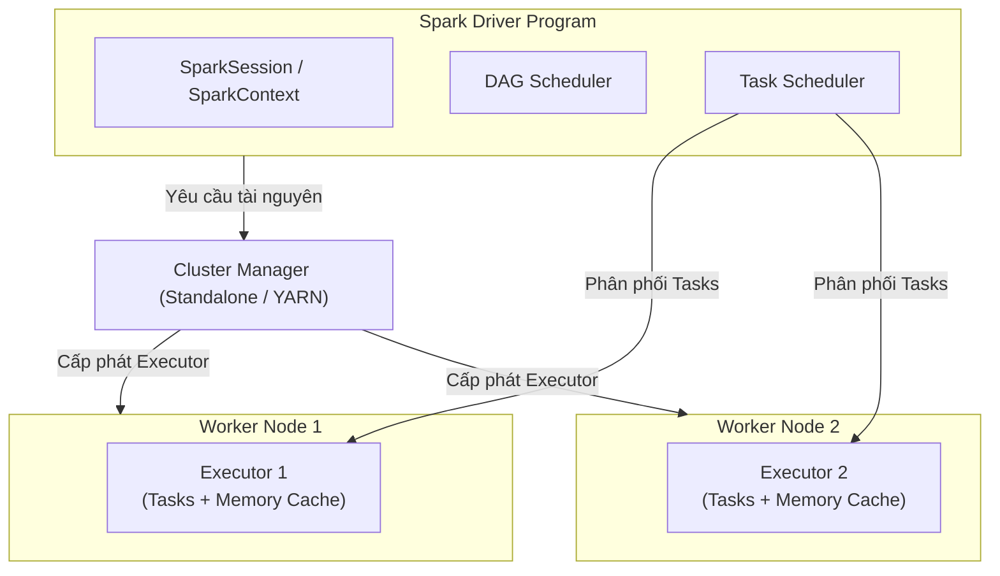
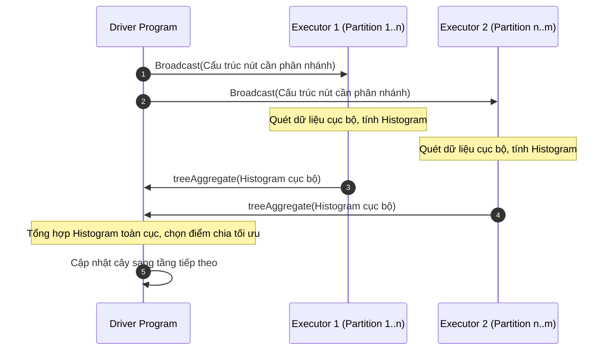

# CHƯƠNG 2: CƠ SỞ LÝ THUYẾT VÀ CÔNG NGHỆ LIÊN QUAN

Chương này trình bày có hệ thống các nền tảng lý thuyết và công nghệ cốt lõi được ứng dụng trong đồ án, bao gồm: lý thuyết Dữ liệu lớn (Big Data), kiến trúc lưu trữ phân tán Hadoop HDFS, khung tính toán phân tán Apache Spark, nguyên lý thuật toán Rừng ngẫu nhiên (Random Forest) trong môi trường phân tán, các thuật toán học máy đối chứng, các độ đo đánh giá mô hình đa lớp, công nghệ lưu trữ cột tối ưu Apache Parquet và kiến trúc phục vụ mô hình hiện đại trên nền tảng FastAPI.

---

## 2.1. Tổng quan về Big Data

### 2.1.1. Khái niệm Big Data
Dữ liệu lớn (Big Data) là thuật ngữ dùng để chỉ các tập dữ liệu có quy mô khổng lồ, tốc độ tăng trưởng nhanh và cấu trúc phức tạp đến mức các phần mềm cơ sở dữ liệu truyền thống (như RDBMS quan hệ) cũng như các công cụ xử lý đơn máy không thể tiếp nhận, quản lý, xử lý và phân tích một cách hiệu quả trong một khoảng thời gian chấp nhận được.

### 2.1.2. Đặc trưng 4V của Big Data trong bài toán hàng không
Tập dữ liệu vận hành hàng không thương mại phản ánh trọn vẹn mô hình 4V kinh điển của Big Data:
1. **Khối lượng (Volume):** Quy mô dữ liệu cực lớn. Với hơn 7 triệu chuyến bay mỗi năm tại Hoa Kỳ, dữ liệu ghi nhận hàng chục triệu sự kiện cất cánh, hạ cánh, lăn bánh và tính toán lịch trình. Dung lượng tệp văn bản thô vượt quá vài Gigabytes và tăng lũy tiến theo từng năm.
2. **Vận tốc (Velocity):** Tốc độ sinh dữ liệu và đòi hỏi xử lý nhanh. Các chuyến bay diễn ra liên tục từng giây; dữ liệu cảm biến bay, thông tin radar thời tiết và tín hiệu kiểm soát không lưu được cập nhật theo thời gian thực (Real-time stream).
3. **Tính đa dạng (Variety):** Dữ liệu đến từ nhiều nguồn khác nhau với các kiểu dữ liệu phong phú: dữ liệu có cấu trúc (bảng lịch trình bay, mã sân bay IATA), dữ liệu bán cấu trúc (thông điệp khí tượng hàng không METAR/TAF, tệp log JSON) và dữ liệu chuỗi thời gian (Time-series delays).
4. **Tính xác thực (Veracity):** Độ tin cậy và sự toàn vẹn của dữ liệu. Do các yếu tố khách quan từ thiết bị thu phát và nhập liệu thủ công tại các sân bay địa phương, dữ liệu hàng không thường xuất hiện giá trị khuyết thiếu, nhiễu và các ngoại lai phi lý (như thời gian lăn bánh âm hoặc giờ cất cánh vượt quá 24h), đòi hỏi các quy trình làm sạch nghiêm ngặt.

### 2.1.3. Giới hạn của xử lý đơn máy và sự cần thiết của tính toán phân tán
Trong mô hình đơn máy (Single-node), khả năng xử lý bị giới hạn bởi trần phần cứng vật lý (RAM, CPU Cores và băng thông bus bộ nhớ). Khi nạp toàn bộ 7.08 triệu dòng dữ liệu vào RAM để tính toán các ma trận đặc trưng lớn:
* **Nghẽn cổ chai bộ nhớ (RAM Bottleneck):** Một tập dữ liệu 2.3 GB dạng CSV khi được giải nén và chuyển đổi sang cấu trúc dữ liệu dạng bảng trong bộ nhớ (như Pandas DataFrame hoặc Scikit-learn NumPy Matrix) thường tiêu tốn lượng RAM gấp 4 đến 8 lần (10 - 18 GB RAM). Khi vượt quá dung lượng RAM thực, hệ điều hành buộc phải kích hoạt cơ chế Swapping/Paging sang ổ đĩa cứng, khiến tốc độ xử lý suy giảm từ vài trăm đến hàng nghìn lần hoặc gây sập tiến trình (Crash due to Out-Of-Memory).
* **Nghẽn cổ chai tính toán (Compute Bottleneck):** Việc xây dựng hàng trăm cây quyết định trên hàng triệu mẫu dữ liệu đòi hỏi hàng tỷ phép so sánh và tính toán độ thuần nhất (Gini/Entropy), vượt quá năng lực xử lý tuần tự của một CPU đơn lẻ.

Để vượt qua những rào cản này, giải pháp phân tán (Distributed Computing) dựa trên mô hình song song hóa dữ liệu (Data Parallelism) được áp dụng: tập dữ liệu khổng lồ được chia nhỏ thành nhiều phần độc lập (Partitions) và phân phối xuống một cụm gồm nhiều nút tính toán (Nodes) để xử lý đồng thời, sau đó tổng hợp kết quả lại tại nút điều phối trung tâm.

---

## 2.2. Hệ thống tệp phân tán Hadoop (HDFS)

### 2.2.1. Tổng quan kiến trúc HDFS
Hệ thống tệp phân tán Hadoop (Hadoop Distributed File System - HDFS) là một hệ thống tệp có khả năng mở rộng quy mô lớn, được thiết kế để lưu trữ các tệp tin có dung lượng từ hàng Gigabytes đến Petabytes trên các cụm máy tính phần cứng thông thường (Commodity Hardware) với cơ chế chịu lỗi cao (Fault Tolerance).

HDFS hoạt động theo kiến trúc Master - Worker (Chủ - Thợ):
* **NameNode (Master):** Quản lý không gian tên của hệ thống tệp (Namespace), duy trì cây thư mục và lưu trữ toàn bộ siêu dữ liệu (Metadata) về vị trí của các khối dữ liệu (Blocks) trên các DataNode. Toàn bộ Metadata của NameNode được lưu giữ trong RAM để đảm bảo tốc độ phản hồi nhanh.
* **DataNode (Worker):** Chịu trách nhiệm lưu trữ và truy xuất các khối dữ liệu vật lý trên ổ đĩa cục bộ theo yêu cầu của Client hoặc NameNode, định kỳ gửi tín hiệu nhịp tim (Heartbeat) và báo cáo khối (Block Report) về cho NameNode để xác nhận trạng thái hoạt động.

### 2.2.2. Cơ chế phân khối (Block) và Nhân bản dữ liệu (Replication)
* **Kích thước khối dữ liệu (Block Size):** Khác với hệ thống tệp thông thường (thường có block 4 KB), HDFS chia tệp tin thành các khối rất lớn (mặc định 128 MB hoặc 256 MB trong Hadoop 3.x). Việc định kích thước khối lớn giúp giảm thiểu chi phí quản lý siêu dữ liệu trên NameNode và tối ưu hóa tốc độ truyền dữ liệu tuần tự theo luồng (Streaming Data Access).
* **Cơ chế nhân bản (Replication Factor):** Để đảm bảo an toàn dữ liệu khi phần cứng gặp sự cố, mỗi khối dữ liệu mặc định được nhân bản thành 3 bản sao ($Replication = 3$) và được lưu trữ trên các DataNode thuộc các giá đỡ (Rack) khác nhau theo chiến lược Rack Awareness, đảm bảo hệ thống vẫn hoạt động trơn tru ngay cả khi một DataNode hoặc toàn bộ một tủ rack bị mất điện đột ngột.

---

## 2.3. Hệ sinh thái tính toán phân tán Apache Spark

### 2.3.1. Tổng quan Apache Spark và ưu thế vượt trội so với MapReduce
Apache Spark là một nền tảng tính toán phân tán đa năng mã nguồn mở, được thiết kế để xử lý dữ liệu quy mô lớn với tốc độ cao. Nếu như mô hình Apache Hadoop MapReduce truyền thống phải ghi toàn bộ kết quả trung gian xuống đĩa cứng HDFS sau mỗi giai đoạn Map và Reduce (gây ra nghẽn cổ chai Disk I/O nghiêm trọng), thì Apache Spark thực hiện toàn bộ việc tính toán trực tiếp trên bộ nhớ truy xuất ngẫu nhiên (**In-Memory Computing**).

Nhờ cơ chế xử lý trong bộ nhớ, Apache Spark có thể đạt tốc độ nhanh hơn Hadoop MapReduce từ **10 đến 100 lần**, đặc biệt phù hợp với các thuật toán học máy mang tính lặp đi lặp lại (Iterative Algorithms) như Random Forest hay Gradient Boosting.

### 2.3.2. Kiến trúc thành phần của Apache Spark
Kiến trúc vận hành của Apache Spark bao gồm các thành phần cốt lõi:
1. **Driver Program:** Là tiến trình chạy hàm `main()` của ứng dụng, chịu trách nhiệm khởi tạo `SparkSession`, phân tích mã nguồn người dùng thành đồ thị tính toán DAG, lập lịch các tác vụ (Task Scheduling) và phân phối công việc xuống các Executor.
2. **Cluster Manager:** Thành phần điều phối và phân bổ tài nguyên vật lý cho ứng dụng Spark (có thể là Spark Standalone Cluster, Apache YARN hoặc Kubernetes).
3. **Executors:** Các tiến trình công nhân (Worker Processes) chạy trên các nút trong cụm, có nhiệm vụ nhận các Task từ Driver, thực thi các phép tính toán trên các phân vùng dữ liệu và lưu trữ dữ liệu vào bộ nhớ hoặc bộ nhớ đệm (Cache/Persist).

### 2.3.3. Các cấu trúc dữ liệu nền tảng
* **RDD (Resilient Distributed Dataset):** Cấu trúc dữ liệu trừu tượng nền tảng của Spark, là tập hợp các đối tượng phân tán chỉ đọc (Immutable), có khả năng tự phục hồi khi có lỗi nhờ lưu trữ đồ thị phả hệ biến đổi (Lineage Graph). RDD cung cấp hai loại thao tác:
  * *Transformations:* Các phép biến đổi dữ liệu (như `map`, `filter`, `groupByKey`) hoạt động theo cơ chế **Đánh giá lười biếng (Lazy Evaluation)** — phép tính chưa được thực thi ngay mà chỉ được ghi nhận vào kế hoạch thực thi.
  * *Actions:* Các phép toán kích hoạt thực thi thực tế (như `count`, `collect`, `save`) để thu về kết quả cuối cùng hoặc lưu xuống đĩa.
* **Spark DataFrame & Dataset:** Lớp trừu tượng bậc cao được xây dựng trên RDD, tổ chức dữ liệu theo các cột có tên và kiểu dữ liệu cụ thể (Schema), tương tự như bảng trong cơ sở dữ liệu quan hệ. DataFrame được tối ưu hóa tự động thông qua bộ tối ưu hóa **Catalyst Optimizer** và cơ chế sinh mã nguồn bytecode tốc độ cao **Tungsten Execution Engine**.

---

## 2.4. Học máy phân tán với Spark MLlib và các thuật toán đối sánh

### 2.4.1. Khái niệm Spark ML Pipeline
Thư viện Spark MLlib cung cấp API hướng đường ống (Pipeline-oriented API) lấy cảm hứng từ Scikit-learn, giúp chuẩn hóa và tự động hóa quy trình huấn luyện học máy trên môi trường phân tán thông qua hai khái niệm cơ bản:
* **Transformer:** Thành phần biến đổi dữ liệu nhận vào một DataFrame và tạo ra một DataFrame mới (thực thi thông qua phương thức `transform()`), ví dụ: `StringIndexer`, `OneHotEncoder`, `VectorAssembler`.
* **Estimator:** Thuật toán học máy tiếp nhận một DataFrame để học các tham số từ dữ liệu và sinh ra một Model (Transformer) hoàn chỉnh (thực thi thông qua phương thức `fit()`), ví dụ: `RandomForestClassifier`.

### 2.4.2. Thuật toán Rừng ngẫu nhiên (Random Forest) và Cơ chế phân tán
Thuật toán Random Forest do Leo Breiman đề xuất (2001) là một phương pháp học tập hợp (Ensemble Learning) kết hợp nhiều Cây quyết định (Decision Trees) độc lập thông qua kỹ thuật **Đóng bao (Bootstrap Aggregating - Bagging)** và **Lấy mẫu ngẫu nhiên không gian đặc trưng (Feature Subsampling)**.

#### 1. Nguyên lý giải thuật toán học
Cho tập dữ liệu huấn luyện $\mathcal{D} = \{(\mathbf{x}_i, y_i)\}_{i=1}^N$ với $\mathbf{x}_i \in \mathbb{R}^d$ và nhãn đa lớp $y_i \in \{0, 1, \dots, C-1\}$.
* **Kỹ thuật Bootstrap:** Với mỗi cây $b = 1, \dots, B$ trong rừng, một tập mẫu con $\mathcal{D}_b$ kích thước $N$ được rút ngẫu nhiên có hoàn lại từ $\mathcal{D}$. Khoảng 63.2% mẫu dữ liệu duy nhất sẽ xuất hiện trong $\mathcal{D}_b$, trong khi 36.8% mẫu còn lại tạo thành tập ngoại bao (Out-Of-Bag - OOB) dùng để ước lượng sai số nội tại.
* **Chọn thuộc tính ngẫu nhiên tại mỗi nút:** Khi phân nhánh tại mỗi nút của cây quyết định, thay vì xét toàn bộ $d$ đặc trưng, thuật toán chỉ chọn ngẫu nhiên một tập con gồm $m$ đặc trưng với $m \ll d$ (thường chọn $m = \lfloor\sqrt{d}\rfloor$). Điểm phân chia tối ưu $(j^*, t^*)$ được chọn để cực đại hóa chỉ số giảm độ vẩn đục (Impurity Reduction), đo lường bằng chỉ số Gini Impurity:
$$\operatorname{Gini}(S) = 1 - \sum_{k=0}^{C-1} p_k^2$$
Trong đó $p_k$ là tỷ lệ mẫu thuộc lớp $k$ trong tập $S$ tại nút đang xét. Mức độ giảm độ vẩn đục khi phân chia tập $S$ thành hai tập con $S_L$ và $S_R$ theo ngưỡng $t$ của thuộc tính $j$:
$$\Delta \operatorname{Gini}(S, j, t) = \operatorname{Gini}(S) - \left( \frac{|S_L|}{|S|} \operatorname{Gini}(S_L) + \frac{|S_R|}{|S|} \operatorname{Gini}(S_R) \right)$$
* **Bỏ phiếu đa số (Majority Voting):** Dự đoán cuối cùng của mô hình cho một mẫu mới $\mathbf{x}$ là kết quả bầu chọn theo đa số của tất cả $B$ cây quyết định:
$$\hat{y} = \arg\max_{k \in \{0, \dots, C-1\}} \sum_{b=1}^B \mathbb{I}(\hat{y}_b(\mathbf{x}) = k)$$

#### 2. Cơ chế phân tán của Random Forest trên Spark MLlib
Trong môi trường dữ liệu lớn với hàng triệu dòng, việc xây dựng cây không thể thực hiện theo cách truyền thống (lưu trữ toàn bộ dữ liệu trên một máy). Spark MLlib triển khai giải thuật song song hóa tìm điểm chia dựa trên **Lược đồ biểu đồ tần suất phân tán (Distributed Histogram-based Split Finding)**:
1. **Phân vùng dữ liệu:** Dữ liệu phân tán trên các phân vùng (Partitions) tại các Executor.
2. **Tính toán cục bộ tại Executor:** Tại mỗi cấp độ của cây (Level-by-level), Driver phát tán (Broadcast) cấu trúc cây hiện tại xuống các Executor. Mỗi Executor chỉ quét các mẫu dữ liệu thuộc phân vùng cục bộ của mình để tính toán Histogram phân bố nhãn cho các điểm chia ứng viên (Candidate Splits) của các thuộc tính được chọn ngẫu nhiên.
3. **Tổng hợp phân tán (Tree Aggregate):** Spark sử dụng hàm `treeAggregate` để tổng hợp có phân cấp các Histogram từ các Worker về Driver với chi phí truyền thông mạng tối thiểu $\mathcal{O}(\log(\text{Workers}))$.
4. **Cập nhật nút tại Driver:** Driver nhận Histogram tổng hợp toàn cục, tính toán điểm phân chia tối ưu nhất và cập nhật thêm một tầng mới cho các cây.

### 2.4.3. Các thuật toán học máy đối chứng (Benchmark Models)
Để đánh giá toàn diện năng lực và vị trí của Random Forest phân tán, đề tài xây dựng 6 mô hình học máy đối chứng:
1. **Logistic Regression (Hồi quy Logistic đa thức - Multinomial Logistic Regression):** Mô hình phân loại tuyến tính cổ điển, sử dụng hàm kích hoạt Softmax để ước lượng xác suất phân lớp. Mô hình làm mốc cơ sở (Baseline) để đánh giá mức độ phi tuyến của dữ liệu.
2. **Decision Tree (Cây quyết định đơn lẻ):** Mô hình cấu trúc cây phân cấp dựa trên thuật toán CART. Đóng vai trò đối chứng trực tiếp để chứng minh sự vượt trội của kỹ thuật tập hợp cây (Ensemble) so với một cây quyết định đơn lẻ vốn rất dễ bị quá khớp (Overfitting).
3. **Extra Trees (Extremely Randomized Trees):** Biến thể của Random Forest nhưng các ngưỡng phân chia (Splits) được chọn ngẫu nhiên hoàn toàn thay vì tìm ngưỡng tối ưu cục bộ. Giúp giảm thêm phương sai (Variance) và tăng tốc độ huấn luyện.
4. **XGBoost (Extreme Gradient Boosting):** Thuật toán tăng cường độ dốc cực trị xây dựng cây tuần tự, tối ưu hóa hàm mục tiêu có điều chuẩn hóa cấp hai (Taylor Expansion 2nd order) và hỗ trợ tăng tốc song song trên GPU.
5. **LightGBM (Light Gradient Boosting Machine):** Thuật toán Boosting phát triển bởi Microsoft, áp dụng kỹ thuật lấy mẫu dựa trên độ dốc (GOSS) và gom cụm thuộc tính độc quyền (EFB), xây dựng cây theo chiều sâu lá (Leaf-wise), tối ưu hóa tốc độ và bộ nhớ.
6. **CatBoost (Categorical Boosting):** Thuật toán Boosting phát triển bởi Yandex, xử lý tối ưu các biến phân loại thông qua kỹ thuật Target Statistics có sắp xếp thời gian (Ordered Boosting) giúp chống rò rỉ thông tin mục tiêu.

---

## 2.5. Các phương pháp đánh giá mô hình phân loại đa lớp

Đối với bài toán phân loại đa lớp ($C = 5$ lớp nguyên nhân trễ) với đặc điểm mất cân bằng dữ liệu tự nhiên, việc sử dụng đơn lẻ độ chính xác tổng thể (Accuracy) là hoàn toàn không đủ. Đề tài áp dụng hệ thống các chỉ số đánh giá chuẩn mực:

### 2.5.1. Độ chính xác tổng thể (Accuracy)
Tỷ lệ giữa tổng số mẫu được dự đoán đúng trên toàn bộ số lượng mẫu trong tập kiểm tra:
$$\text{Accuracy} = \frac{\sum_{k=0}^{C-1} TP_k}{N_{test}}$$

### 2.5.2. Precision, Recall và F1-Score từng lớp
Đối với mỗi lớp $k \in \{0, \dots, C-1\}$, các đại lượng True Positive ($TP_k$), False Positive ($FP_k$), False Negative ($FN_k$) được tính toán:
$$\text{Precision}_k = \frac{TP_k}{TP_k + FP_k}, \quad \text{Recall}_k = \frac{TP_k}{TP_k + FN_k}$$
$$F1_k = 2 \times \frac{\text{Precision}_k \times \text{Recall}_k}{\text{Precision}_k + \text{Recall}_k}$$

### 2.5.3. Macro-averaged và Weighted-averaged F1-Score
* **Macro F1-Score:** Trung bình số học không trọng số của F1-Score trên tất cả các lớp. Chỉ số này đánh giá công bằng năng lực dự đoán trên tất cả các lớp, đặc biệt nhạy cảm với các lớp thiểu số (Minority classes) như `SecurityDelay`:
$$\text{Macro F1} = \frac{1}{C} \sum_{k=0}^{C-1} F1_k$$
* **Weighted F1-Score:** Trung bình có trọng số của F1-Score theo số lượng mẫu thực tế ($N_k$) của từng lớp. Chỉ số này phản ánh hiệu năng thực tế trên toàn bộ phân phối dữ liệu:
$$\text{Weighted F1} = \sum_{k=0}^{C-1} \left( \frac{N_k}{N_{test}} \times F1_k \right)$$

### 2.5.4. Ma trận nhầm lẫn (Confusion Matrix)
Ma trận vuông kích thước $C \times C$, trong đó phần tử tại hàng $i$ và cột $j$ biểu diễn số lượng mẫu thực tế thuộc lớp $i$ nhưng được mô hình dự đoán vào lớp $j$. Ma trận nhầm lẫn cung cấp cái nhìn chi tiết nhất về các cặp nhãn thường xuyên bị phân loại sai (như sự nhầm lẫn giữa trễ do hãng bay `Carrier` và trễ do máy bay đến muộn `LateAircraft`).

---

## 2.6. Định dạng lưu trữ tối ưu Apache Parquet

### 2.6.1. Nguyên lý lưu trữ dạng cột (Columnar Storage)
Khác với định dạng văn bản dạng hàng truyền thống như CSV (Row-oriented) lưu trữ tuần tự từng bản ghi, Apache Parquet là định dạng lưu trữ hướng cột mở (Open-source Columnar Storage) được thiết kế chuyên biệt cho hệ sinh thái Big Data.

Trong các truy vấn phân tích và học máy, mô hình thường chỉ cần trích xuất một số cột thuộc tính nhất định (ví dụ 10 cột trong tổng số 35 cột). 
* Với CSV: Hệ thống bắt buộc phải đọc toàn bộ 35 cột của cả tệp dữ liệu vào bộ nhớ rồi mới tiến hành loại bỏ cột thừa (gây lãng phí băng thông đĩa và RAM).
* Với Parquet: Hệ thống chỉ đọc chính xác các khối dữ liệu của các cột được yêu cầu (**Projection Pushdown**), bỏ qua hoàn toàn các cột không sử dụng.

### 2.6.2. Kỹ thuật nén Snappy và Mã hóa dữ liệu (Encoding)
Do các giá trị trong cùng một cột có cùng kiểu dữ liệu và thường có tính lặp lại cao, Parquet áp dụng các kỹ thuật mã hóa hiệu quả:
* **Dictionary Encoding:** Thay thế các chuỗi ký tự lặp lại (như mã sân bay 'JFK', 'LAX') bằng các số nguyên nhỏ gọn.
* **Run-Length Encoding (RLE) & Bit-Packing:** Nén chuỗi các giá trị liên tiếp giống nhau.
* **Thuật toán nén Snappy:** Thuật toán nén tốc độ cao của Google, cân bằng tối ưu giữa tỷ lệ nén (giảm hơn 80% dung lượng) và tốc độ giải nén cực nhanh mà không gây quá tải CPU.

### 2.6.3. Kỹ thuật đẩy bộ lọc xuống đĩa (Predicate Pushdown)
Tệp Parquet lưu trữ siêu dữ liệu thống kê (Metadata) bao gồm giá trị nhỏ nhất ($Min$) và lớn nhất ($Max$) cho từng nhóm dòng (Row Group). Khi thực hiện truy vấn lọc (ví dụ: `Month == 12`), Spark sẽ kiểm tra metadata và bỏ qua ngay lập tức hàng loạt Row Group không thỏa mãn điều kiện mà không cần đọc dữ liệu chi tiết, giúp tăng tốc độ đọc dữ liệu lên gấp nhiều lần.

---

## 2.7. Công nghệ Serving và Giao diện Dashboard (FastAPI)

Để đưa các kết quả nghiên cứu vào ứng dụng thực tiễn, việc xây dựng một giao diện phục vụ suy luận (Serving Framework) và bảng điều khiển (Dashboard) là không thể thiếu:
* **FastAPI:** Nền tảng phát triển Web API bằng Python hiện đại, hiệu năng cực cao dựa trên chuẩn giao tiếp không đồng bộ ASGI (Asynchronous Server Gateway Interface - thông qua máy chủ Uvicorn) và thư viện xác thực dữ liệu Pydantic. FastAPI có khả năng xử lý hàng chục nghìn yêu cầu mỗi giây với độ trễ tính bằng mili-giây, cho phép nạp sẵn các mô hình học máy vào bộ nhớ và trả về kết quả dự đoán gần như tức thì.
* **Modern Web Dashboard:** Giao diện điều khiển sử dụng công nghệ HTML5/CSS3 hiện đại và JavaScript thuần (Vanilla JS), loại bỏ các thư viện cồng kềnh giúp tối ưu hóa thời gian tải trang, hiển thị trực quan các biểu đồ phân tích và bảng đối sánh đa mô hình.

---

## 2.8. Tổng kết chương

Chương 2 đã hệ thống hóa toàn diện các cơ sở lý luận khoa học và công nghệ của đồ án. Sự kết hợp giữa khả năng lưu trữ hướng cột vượt trội của **Apache Parquet**, sức mạnh xử lý trong bộ nhớ của **Apache Spark**, thuật toán **Random Forest phân tán** trên nền tảng **Spark MLlib** và kiến trúc phục vụ mô hình của **FastAPI** tạo nên một nền tảng kỹ thuật vững chắc, giải quyết triệt để bài toán phân tích và dự đoán nguyên nhân trễ chuyến bay trên tập dữ liệu hơn 7 triệu dòng của năm 2024.
