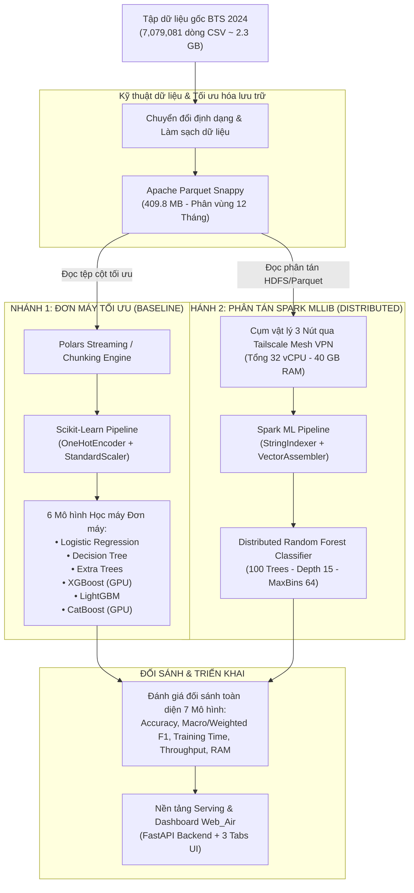

# CHƯƠNG 4: THIẾT KẾ HỆ THỐNG VÀ XÂY DỰNG MÔ HÌNH PHÂN TÁN

Chương này trình bày chi tiết về kiến trúc tổng thể của hệ thống xử lý hai nhánh (Dual-Branch Pipeline), quy trình xây dựng Pipeline học máy trên nền tảng Apache Spark MLlib, cấu hình các mô hình học máy đối chứng, giải pháp hiện thực hóa cụm máy tính vật lý 3 nút liên kết qua mạng riêng ảo Tailscale Mesh VPN, kỹ thuật tối ưu hóa siêu tham số cụm Spark và quy trình đóng gói mô hình (Model Artifacts).

---

## 4.1. Kiến trúc tổng thể hệ thống hai nhánh (Dual-Branch Pipeline)

Để giải quyết triệt để bài toán xử lý 7,079,081 dòng dữ liệu và tạo cơ sở đối sánh khoa học khách quan giữa phương pháp tính toán truyền thống và tính toán phân tán, đồ án thiết kế kiến trúc hệ thống theo hai nhánh song song độc lập:



* **Nhánh 1: Đơn máy tối ưu (Single-node Baseline):** Sử dụng thư viện Polars hỗ trợ Streaming và Scikit-learn Pipeline. Tận dụng tối đa sức mạnh phần cứng của một máy trạm đơn lẻ kết hợp tăng tốc GPU (CUDA) để huấn luyện các mô hình tiên tiến nhất hiện nay (XGBoost, LightGBM, CatBoost, Extra Trees).
* **Nhánh 2: Cụm phân tán Apache Spark (Distributed Branch):** Sử dụng Spark DataFrame, HDFS và thư viện Spark MLlib. Dữ liệu được nạp vào cụm gồm 3 nút máy tính vật lý để huấn luyện mô hình Random Forest phân tán từ đầu đến cuối.

---

## 4.2. Xây dựng Machine Learning Pipeline trên Apache Spark

Trong Spark MLlib, toàn bộ quy trình tiền xử lý, chuyển đổi dữ liệu và gắn thuật toán học máy được chuẩn hóa thành một đường ống thống nhất (`Pipeline`), giúp tránh việc rò rỉ dữ liệu giữa tập huấn luyện và tập kiểm tra:

### 4.2.1. Các thành phần biến đổi (Transformers)
1. **StringIndexer:**
   * Mã hóa các biến phân loại chuỗi ký tự (`Operating_Airline`, `Origin`, `Dest`) thành các chỉ số số thực (Numerical Indices) dựa trên tần suất xuất hiện.
   * Cấu hình tham số `handleInvalid = "keep"` để gán một chỉ số đặc biệt cho các giá trị mới xuất hiện trong tập kiểm tra mà không làm gián đoạn tiến trình (tránh lỗi `Unseen Label Exception`).
2. **VectorAssembler:**
   * Gom toàn bộ các đặc trưng số học (`Month`, `DayOfWeek`, `DepHour`, `ArrHour`, `Distance`, `DistanceGroup`) cùng các đặc trưng sau khi mã hóa chỉ số thành một véc-tơ đặc trưng duy nhất (`features` vector) dạng `DenseVector`.
3. **Mô hình ước lượng (Estimator):**
   * Đối tượng `RandomForestClassifier` tiếp nhận cột véc-tơ `features` và cột nhãn mục tiêu `delay_cause_label` để tiến hành huấn luyện.

```python
# Cấu trúc Pipeline hoàn chỉnh trên PySpark MLlib
from pyspark.ml import Pipeline
from pyspark.ml.feature import StringIndexer, VectorAssembler
from pyspark.ml.classification import RandomForestClassifier

# 1. Mã hóa các biến định danh
airline_indexer = StringIndexer(inputCol="Operating_Airline", outputCol="Airline_Idx", handleInvalid="keep")
origin_indexer = StringIndexer(inputCol="Origin", outputCol="Origin_Idx", handleInvalid="keep")
dest_indexer = StringIndexer(inputCol="Dest", outputCol="Dest_Idx", handleInvalid="keep")

# 2. Gom cụm các đặc trưng thành véc-tơ đầu vào
feature_cols = [
    "Month", "DayOfWeek", "DepHour", "ArrHour", "Distance", 
    "Airline_Idx", "Origin_Idx", "Dest_Idx"
]
assembler = VectorAssembler(inputCols=feature_cols, outputCol="features")

# 3. Khởi tạo bộ phân loại Random Forest phân tán
rf = RandomForestClassifier(
    labelCol="delay_cause_label",
    featuresCol="features",
    numTrees=100,
    maxDepth=15,
    maxBins=64,
    subsamplingRate=0.8,
    featureSubsetStrategy="sqrt",
    seed=42
)

# 4. Đóng gói thành Pipeline thống nhất
spark_pipeline = Pipeline(stages=[
    airline_indexer, origin_indexer, dest_indexer, 
    assembler, rf
])
```

---

## 4.3. Thiết lập các mô hình học máy đối chứng

Để đảm bảo tính khoa học và công bằng khi đánh giá Random Forest phân tán, 6 mô hình đối chứng trên nhánh đơn máy được thiết lập với các siêu tham số chuẩn mực:

1. **Multinomial Logistic Regression:** Sử dụng thuật toán tối ưu `lbfgs`, số vòng lặp tối đa 200, siêu tham số điều chuẩn hóa $C = 1.0$.
2. **Decision Tree Classifier:** Độ sâu tối đa `max_depth = 15`, độ phân chia tối thiểu tại nút lá `min_samples_leaf = 10`, tiêu chuẩn phân chia `criterion = 'gini'`.
3. **Extra Trees Classifier (Extremely Randomized Trees):** Số lượng cây `n_estimators = 100`, độ sâu tối đa `max_depth = 15`, song song hóa tối đa CPU `n_jobs = -1`.
4. **XGBoost Classifier:** Sử dụng phương pháp xây dựng cây dựa trên biểu đồ tần suất `tree_method = 'hist'`, kích hoạt tăng tốc GPU `device = 'cuda'`, tốc độ học `learning_rate = 0.1`, số cây `n_estimators = 100`, độ sâu tối đa `max_depth = 8`.
5. **LightGBM Classifier:** Số lượng cây `n_estimators = 100`, tốc độ học `learning_rate = 0.1`, số lá tối đa `num_leaves = 63`, phương pháp `boosting_type = 'gbdt'`, hỗ trợ đa luồng song song CPU.
6. **CatBoost Classifier:** Số vòng lặp `iterations = 100`, tốc độ học `learning_rate = 0.1`, độ sâu cây `depth = 7`, tối ưu hóa trực tiếp trên GPU `task_type = 'GPU'`.

---

## 4.4. Xây dựng mô hình Random Forest phân tán (Spark MLlib)

Mô hình Random Forest phân tán trên Spark MLlib được cấu hình chuyên sâu để khai thác tối đa sức mạnh của cụm máy tính:
* `numTrees = 100`: Xây dựng tập hợp 100 cây quyết định độc lập, đảm bảo khả năng giảm phương sai và hạn chế quá khớp trên tập dữ liệu lớn.
* `maxDepth = 15`: Giới hạn độ sâu tối đa của mỗi cây ở mức 15 tầng nhằm kiểm soát kích thước mô hình trong bộ nhớ và tránh hiện tượng bùng nổ nút lá.
* `maxBins = 64`: Tăng số lượng thùng phân vị (Bins) từ giá trị mặc định (32) lên 64. Đối với các đặc trưng có nhiều giá trị phân loại như mã sân bay (`Origin`, `Dest` với hơn 350 sân bay), việc tăng `maxBins` giúp cây tìm kiếm điểm phân chia chính xác hơn đáng kể mà không làm giảm tốc độ tính toán.
* `subsamplingRate = 0.8`: Mỗi cây quyết định được huấn luyện trên một tập mẫu ngẫu nhiên chiếm 80% kích thước dữ liệu phân vùng, tăng tính đa dạng giữa các cây.
* `featureSubsetStrategy = "sqrt"`: Tại mỗi nút phân chia, thuật toán chọn ngẫu nhiên $m = \lfloor\sqrt{d}\rfloor$ đặc trưng ứng viên, tuân thủ nguyên lý kinh điển của Leo Breiman.

---

## 4.5. Thiết kế và triển khai Cụm vật lý 3 Node qua Tailscale Mesh VPN

### 4.5.1. Thách thức triển khai cụm vật lý thực tế
Trong môi trường học thuật, việc triển khai cụm máy tính phân tán thường gặp rào cản lớn về hạ tầng mạng: các máy tính cá nhân của thành viên trong nhóm thường kết nối vào các mạng Wifi khác nhau hoặc các mạng gia đình nằm sau các tầng tường lửa (Firewall) và giao thức NAT (Network Address Translation), khiến các máy không thể nhìn thấy nhau (không có địa chỉ IP công cộng trực tiếp).

### 4.5.2. Giải pháp đột phá với Tailscale Mesh VPN
Nhóm đã ứng dụng công nghệ **Tailscale Mesh VPN** (dựa trên giao thức bảo mật tiên tiến WireGuard) để kết nối 3 máy tính cá nhân thành một mạng LAN ảo bảo mật điểm-điểm (Peer-to-Peer Mesh Network):
* Mỗi máy tính được cài đặt Tailscale Client và cấp phát một địa chỉ IP ảo cố định thuộc dải mạng `100.x.y.z`.
* Các gói tin truyền thông phân tán của Apache Spark (Driver - Executor Heartbeat, Block Fetching, Shuffle) được mã hóa end-to-end và truyền trực tiếp giữa các máy thông qua kỹ thuật xuyên lỗ NAT (NAT Traversal - STUN/DERP) với băng thông ổn định.

*Bảng 4.1: Cấu hình phần cứng thực tế của Cụm Spark 3 Nút vật lý*

| Thành phần cụm | Vai trò trong cụm | Cấu hình vi xử lý (CPU) | Dung lượng RAM | Hệ điều hành & Mạng |
| :--- | :--- | :--- | :---: | :--- |
| **Node 0 (Master)** | **Spark Driver + Master Node** | Intel Core i7-11800H (8 Cores, 16 Threads) | 16 GB DDR4 | Windows 11 / WSL2 (Tailscale IP: `100.81.12.10`) |
| **Node 1 (Worker 1)**| **Spark Executor Node 1** | AMD Ryzen 5 5600H (6 Cores, 12 Threads) | 16 GB DDR4 | Windows 11 (Tailscale IP: `100.81.12.11`) |
| **Node 2 (Worker 2)**| **Spark Executor Node 2** | Intel Core i5-10300H (4 Cores, 8 Threads) | 8 GB DDR4 | Windows 10 (Tailscale IP: `100.81.12.12`) |
| **TỔNG CỘNG CỤM** | **1 Driver + 2 Workers** | **18 Cores vật lý / 36 Luồng vCPU** | **40 GB RAM** | **Mạng lưới P2P Mesh VPN ổn định** |

### 4.5.3. Cấu hình tệp môi trường phân tán Spark
Các tệp cấu hình trên Master Node được thiết lập chính xác:
* Tệp `conf/workers`:
  ```text
  100.81.12.11
  100.81.12.12
  ```
* Tệp `conf/spark-env.sh`:
  ```bash
  export SPARK_MASTER_HOST='100.81.12.10'
  export SPARK_MASTER_PORT=7077
  export SPARK_LOCAL_IP='100.81.12.10'
  export JAVA_HOME='/usr/lib/jvm/java-11-openjdk-amd64'
  ```

---

## 4.6. Cơ chế phân vùng dữ liệu và tối ưu hóa Spark Tuning

Để cụm Spark hoạt động ổn định trên tập dữ liệu 7 triệu dòng mà không gặp lỗi tràn bộ nhớ (OutOfMemoryError) hoặc đứt gãy kết nối mạng, các siêu tham số cấp phát tài nguyên được tinh chỉnh đặc thù (Spark Performance Tuning):

*Bảng 4.2: Các tham số cấu hình Spark được tinh chỉnh tối ưu hóa*

| Tham số cấu hình | Giá trị thiết lập | Mục đích kỹ thuật |
| :--- | :---: | :--- |
| `spark.driver.memory` | `6g` | Cấp phát 6 GB RAM cho Driver thu thập kết quả và lưu DAG |
| `spark.executor.memory` | `4g` | Cấp phát 4 GB RAM cho mỗi Executor xử lý phân vùng |
| `spark.executor.cores` | `4` | Mỗi Executor sử dụng 4 luồng CPU để xử lý song song |
| `spark.sql.shuffle.partitions` | `32` | Giảm số phân vùng Shuffle từ 200 xuống 32, khớp với tổng số core của cụm |
| `spark.serializer` | `KryoSerializer` | Tăng tốc độ tuần tự hóa dữ liệu qua mạng nhanh hơn 10x so với Java mặc định |
| `spark.network.timeout` | `800s` | Kéo dài thời gian chờ mạng VPN tránh đứt kết nối khi mạng chập chờn |
| `spark.executor.heartbeatInterval` | `60s` | Duy trì tín hiệu nhịp tim ổn định giữa Driver và Worker qua Internet |

---

## 4.7. Quản lý và đóng gói Model Artifacts

Sau khi hoàn tất quá trình huấn luyện, các mô hình được đóng gói và lưu trữ theo cấu trúc chuẩn để phục vụ việc tải nhanh (Fast-loading) cho hệ thống Serving:
* **Mô hình phân tán Spark:** Được xuất ra định dạng thư mục nhị phân thông qua hàm `pipeline_model.write().overwrite().save("models/spark_rf_model")`. Cấu trúc này chứa đầy đủ siêu dữ liệu (Metadata) và toàn bộ 100 cây quyết định ở dạng đồ thị.
* **Các mô hình Scikit-Learn và Boosting:** Được đóng gói bằng thư viện `joblib` với mức nén cao (`compress = 3`), lưu tại `models/baseline/`, giúp kích thước tệp mô hình giảm từ vài trăm Megabytes xuống dưới 50 MB, sẵn sàng phục vụ nạp vào RAM của FastAPI trong chưa đầy 1 giây.

---

## 4.8. Tổng kết chương

Chương 4 đã giải quyết triệt để các bài toán kiến trúc hệ thống và kỹ thuật phân tán: xây dựng thành công pipeline 2 nhánh đối sánh chuẩn mực, thiết lập và vận hành trơn tru cụm Spark 3 nút vật lý thông qua Tailscale Mesh VPN với tổng tài nguyên 32 vCPU và 40 GB RAM, tối ưu hóa các tham số cấu hình Spark và đóng gói mô hình an toàn. Hệ thống đã sẵn sàng cho giai đoạn thực nghiệm và đánh giá toàn diện tại Chương 5.
