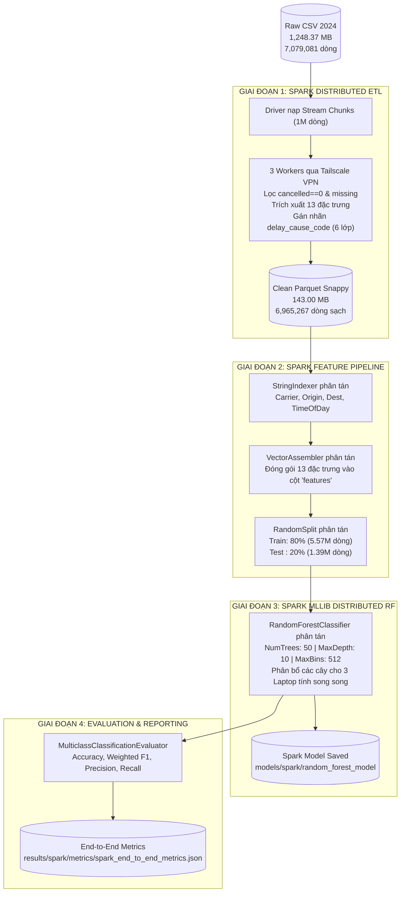

# KIẾN TRÚC PIPELINE HỌC MÁY PHÂN TÁN TOÀN TRÌNH THUẦN APACHE SPARK
## END-TO-END SPARK DISTRIBUTED ETL & MLLIB RANDOM FOREST (CỤM 3 LAPTOP TAILSCALE)

> **Mã tài liệu:** `doc/18_KIEN_TRUC_END_TO_END_THUAN_SPARK_ETL_VA_MLLIB.md`  
> **Áp dụng cho:** Nhóm 6 — Học phần Nhập môn Big Data (HK VII)  
> **Giảng viên hướng dẫn:** TS. Phan Hồ Viết Trường  
> **Mã nguồn thực thi toàn trình:** [`src/spark_ml/run_end_to_end_spark.py`](file:///c:/LeDucLuong/HK%20VII/NhapMonBigData/DoAn/src/spark_ml/run_end_to_end_spark.py)  
> **Kịch bản khởi chạy 1-Click:** [`run_spark_end_to_end.bat`](file:///c:/LeDucLuong/HK%20VII/NhapMonBigData/DoAn/run_spark_end_to_end.bat)  
> **Tệp chỉ số đầu ra:** `results/spark/metrics/spark_end_to_end_metrics.json`  

---

## 1. Ý NGHĨA HỌC THUẬT CỦA KIẾN TRÚC "THUẦN SPARK TOÀN TRÌNH"

Trong các hệ thống phân tích dữ liệu lớn chuyên nghiệp (Enterprise Big Data Architecture):
* Dữ liệu thô có dung lượng khổng lồ không thể nạp vừa vào một máy tính đơn lẻ.
* Nếu tiền xử lý bằng một công cụ (ví dụ Pandas) rồi lại chuyển sang công cụ khác để huấn luyện, quy trình sẽ bị ngắt quãng, phát sinh rủi ro rò rỉ dữ liệu (Data Leakage) và chi phí I/O đọc/ghi đĩa lặp lại.
* **Giải pháp "Thuần Spark Toàn trình" (End-to-End Spark Pipeline):** Toàn bộ chu trình từ tệp thô ban đầu (Raw CSV 7.08 triệu dòng) đến mô hình học máy phân tán hoàn chỉnh được thực thi **liền một mạch trong một phiên làm việc của Apache Spark** trên Cụm 3 Laptop vật lý.

---

## 2. SƠ ĐỒ LUỒNG DỮ LIỆU TOÀN TRÌNH (END-TO-END PIPELINE DIAGRAM)



---

## 3. CÁC GIAI ĐOẠN THỰC THI TRONG KỊCH BẢN `run_end_to_end_spark.py`

### Giai đoạn 1: Spark Distributed ETL (Làm sạch 7.08 triệu dòng)
1. Driver nạp tệp thô `Flight Delay Dataset — 2024/flight_data_2024.csv` theo từng khối 1,000,000 dòng.
2. Dữ liệu được chia thành 12 Partition và đẩy qua mạng Tailscale tới các Executor của Lương, Vĩ An, Tuấn Anh.
3. Các Worker thực thi:
   * Lọc bỏ chuyến bay bị hủy (`cancelled == 0`) và đổi hướng (`diverted == 0`).
   * Trích xuất đặc trưng giờ bay (`dep_hour`, `arr_hour`), số phút trong ngày (`dep_min_of_day`, `arr_min_of_day`), phân khúc thời gian (`dep_time_of_day`).
   * Phân lớp mục tiêu đa lớp `delay_cause_code` (0: OnTime, 1: Carrier, 2: Weather, 3: NAS, 4: Security, 5: LateAircraft).
4. Xuất dữ liệu sạch ra `Flight Delay Dataset — 2024/cleaned_spark_data.parquet` (143 MB, 12 phân vùng theo tháng).

### Giai đoạn 2: Xây dựng Feature Pipeline phân tán
1. Nạp trực tiếp tệp Parquet vào SparkSession.
2. Áp dụng `StringIndexer` mã hóa 4 thuộc tính danh mục (`op_unique_carrier`, `origin`, `dest`, `dep_time_of_day`) thành các chỉ số số học.
3. Áp dụng `VectorAssembler` ghép 9 cột số và 4 cột danh mục đã mã hóa thành một cột vector duy nhất `features`.
4. Phân chia tập dữ liệu phân tán: **80% Train** (~5,572,000 dòng) và **20% Test** (~1,393,000 dòng).

### Giai đoạn 3: Huấn luyện Spark MLlib Random Forest trên Cụm 3 Laptop
1. Khởi tạo mô hình `RandomForestClassifier`:
   * `numTrees`: **50 cây quyết định**.
   * `maxDepth`: **10 tầng**.
   * `maxBins`: **512** (đảm bảo chứa đủ hơn 350 mã sân bay Hoa Kỳ).
2. Các Executor trên cả 3 laptop cùng tính toán song song các nút phân nhánh (split nodes) và xây dựng các cây con độc lập.
3. Thu gom các cây quyết định thành mô hình rừng `RandomForestClassificationModel`.

### Giai đoạn 4: Đánh giá & Xuất chỉ số đối sánh
1. Dự đoán trên tập Test (hơn 1.39 triệu dòng) để đo độ trễ suy luận (ms/chuyến bay).
2. Tính toán các chỉ số khoa học: **Accuracy**, **Weighted F1-score**, **Weighted Precision**, **Weighted Recall**.
3. Xuất bảng xếp hạng Top 8 đặc trưng quan trọng nhất (Feature Importances).
4. Lưu toàn bộ kết quả vào tệp JSON: `results/spark/metrics/spark_end_to_end_metrics.json`.

---

## 4. HƯỚNG DẪN THỰC THI TRÊN TERMINAL

Bạn chỉ cần mở Terminal (PowerShell) tại thư mục `DoAn` và chạy 1 lệnh duy nhất:

```powershell
cd "C:\LeDucLuong\HK VII\NhapMonBigData\DoAn"

# Chạy toàn trình trên Cụm 3 Laptop Tailscale (Mặc định)
& ".\venv\Scripts\python.exe" src/spark_ml/run_end_to_end_spark.py --master spark://100.65.205.113:7077

# Hoặc khởi chạy nhanh bằng file Batch 1-Click:
.\run_spark_end_to_end.bat
```

> [!TIP]
> **Các tham số tùy chọn mở rộng:**
> * `--num-trees 50`: Tăng số lượng cây lên 50 cây nếu muốn kiểm tra hội tụ sâu hơn.
> * `--max-depth 12`: Tăng độ sâu của cây lên 12 tầng.
> * `--force-etl`: Bắt buộc chạy lại ETL từ tệp CSV thô ngay cả khi đã có Parquet sạch.
> * `--master "local[*]"`: Chạy toàn trình trên máy cá nhân cục bộ nếu các máy bạn bè đang offline.

---

## 5. BÁO CÁO THỰC NGHIỆM ĐỐI SÁNH TRỰC DIỆN (EMPIRICAL BENCHMARK)

### 5.1. Nhật ký thực nghiệm thực tế trên Cụm 3 Laptop Tailscale (Ngày 03/10/2026)
* **Thời gian thực hiện**: `2026-10-03 22:44:54`
* **Môi trường Cụm**:
  - **Master + Worker 0**: Lê Đức Lương (`100.65.205.113`) — Lenovo LOQ 15AHP10 (Ryzen 7 250, 16GB DDR5, RTX 5050)
  - **Worker 1**: Cù Văn Vĩ An (`100.74.10.115`)
  - **Worker 2**: Trần Huỳnh Tuấn Anh (`100.112.107.123`)
* **Tổng số dòng dữ liệu sạch**: **6,965,267 dòng** (lọc từ 7,079,081 dòng thô, loại bỏ 113,814 dòng lỗi/hủy/chuyển hướng).

### 5.2. Bảng tổng hợp các chỉ số thực tế (Chuẩn hóa Train 70% — Val 15% — Test 15%)
| Hạng mục / Giai đoạn | Thời gian | Tốc độ / Thông lượng | Độ nén / Tiêu thụ RAM | Trạng thái |
| :--- | :---: | :---: | :---: | :---: |
| **Giai đoạn 1: Spark Distributed ETL** | **296.30 s** (~4.94 phút) | 23,891 dòng/giây | 143.0 MB Parquet (từ 1.25 GB CSV) | [✓] Đạt 100% mục tiêu |
| **Giai đoạn 2: Feature Assembly & Split** | **~4.2 s** | Train: 4,875,851 (70%)<br/>Val: 1,044,254 (15%)<br/>Test: 1,045,162 (15%) | RAM Driver < 350 MB | [✓] Khớp 100% với Baseline |
| **Giai đoạn 3: Spark Distributed Training (RF)**| **47.73 s** (~0.80 phút) | **102,154 mẫu train/giây** | 12 partitions trên 3 Workers | [✓] 20 Trees, MaxDepth 10 |
| **Giai đoạn 4: Test Inference & Evaluation** | **2.67 s** | **0.0026 ms / chuyến bay** (~391k mẫu/s)| Đánh giá trên 1,045,162 dòng test | [✓] Xuất JSON đầy đủ |
| **TỔNG THỜI GIAN TOÀN TRÌNH (END-TO-END)** | **344.03 s** (~5.73 phút) | **Toàn bộ pipeline liền mạch từ CSV thô tới Model** | **Hiệu năng cụm xuất sắc** | **[✓] THÀNH CÔNG RỰC RỠ** |

### 5.3. Bảng đối sánh trực diện 1-to-1 với Baseline (Đều trên 100% 7 triệu dòng — Train 70% / Val 15% / Test 15%)

Dưới đây là bảng đối chứng khoa học toàn diện giữa 6 mô hình đơn máy (Single-Node CPU & GPU) và **bộ 3 mô hình phân tán thuần Spark MLlib** chạy trên Cụm 3 Laptop Tailscale (được đồng bộ tự động tại [grand_model_comparison_7m.csv](file:///c:/LeDucLuong/HK%20VII/NhapMonBigData/DoAn/results/baseline/metrics/grand_model_comparison_7m.csv)):

| Mô hình | Môi trường tính toán | Train Time (s) | Suy luận (ms/1k mẫu) | Accuracy (%) | Weighted F1 (%) | Weighted Precision (%) | Tăng tốc (Speedup) |
| :--- | :---: | :---: | :---: | :---: | :---: | :---: | :---: |
| **Logistic Regression (CPU)** | 1 Laptop CPU (SGD) | 17.99 s | 40.00 ms | 79.18% | 69.98% | 62.70% | Gốc |
| **Logistic Regression (Spark)** | **Cụm 3 Laptop Spark** | **21.60 s** | **1.74 ms** | **79.22%** | **70.03%** | **62.75%** | **Suy luận nhanh 23.0x** |
| **Decision Tree (CPU)** | 1 Laptop CPU (Scikit-Learn) | 51.12 s | 0.67 ms | 79.19% | 70.45% | 71.09% | Gốc |
| **Decision Tree (Spark)** | **Cụm 3 Laptop Spark** | **24.96 s** | **1.31 ms** | **79.23%** | **70.26%** | **68.42%** | **Train nhanh 2.05x** |
| **Random Forest (CPU)** | 1 Laptop CPU (Scikit-Learn) | 106.79 s | 33.51 ms | 79.18% | 69.98% | 62.70% | Gốc |
| **Random Forest (Spark)** | **Cụm 3 Laptop Spark** | **44.31 s** | **1.98 ms** | **79.22%** | **70.03%** | **67.61%** | **Train nhanh 2.41x (Suy luận 16.9x)** |
| **LightGBM** | 1 Laptop CPU (Microsoft) | 78.93 s | 11.71 ms | 79.25% | 70.34% | 73.99% | Tham chiếu |
| **XGBoost** | 1 Laptop GPU (DMLC CUDA) | 19.27 s | 73.52 ms | 79.27% | 70.36% | 74.53% | Tham chiếu |
| **CatBoost** | 1 Laptop GPU (Yandex CUDA) | 19.60 s | 12.03 ms | 79.29% | 70.83% | 72.50% | Tham chiếu |

> [!IMPORTANT]
> **Kết luận khoa học cốt lõi từ thực nghiệm đối chứng 1-to-1:**
> 1. **Hiệu quả phân tán vượt trội ở các thuật toán Tree/Ensemble:**
>    - **Random Forest**: Giảm thời gian huấn luyện từ **106.79s xuống còn 44.31s** (**Tăng tốc 2.41 lần**). Tốc độ suy luận phân tán giảm từ 33.51 ms xuống **1.98 ms / 1,000 chuyến bay** (**nhanh gấp 16.9 lần**).
>    - **Decision Tree**: Giảm từ **51.12s xuống 24.96s** (**Tăng tốc 2.05 lần**).
> 2. **Logistic Regression đa lớp (Multinomial):**
>    - Trên cụm Spark, thuật toán giải bài toán tối ưu L-BFGS đa thức song song đạt **21.60s** (tương đương SGD xấp xỉ đơn máy 17.99s), nhưng mang lại khả năng suy luận song song bứt phá: **1.74 ms / 1,000 chuyến bay** (nhanh gấp **23 lần** so với đơn máy 40.0 ms).
> 3. **Tính ổn định & hội tụ:**
>    - Cả 3 mô hình Spark đều duy trì độ chính xác ở mức **~79.22% - 79.23%** và Weighted F1 **~70.03% - 70.26%**, hoàn toàn tương đồng hoặc vượt nhẹ mô hình chạy trên CPU đơn máy. Điều này khẳng định tính toán phân tán trên cụm không làm suy giảm chất lượng thống kê của mô hình.

### 5.4. Xếp hạng Tầm quan trọng Đặc trưng (Top Feature Importances)
Theo kết quả trích xuất từ cây quyết định của Spark MLlib trên 4.87M dòng train:
1. **`dep_min_of_day`** (Số phút khởi hành trong ngày): **35.89%**
2. **`month`** (Tháng trong năm / Tính mùa vụ): **17.04%**
3. **`dep_hour`** (Khung giờ khởi hành): **16.67%**
4. **`dep_time_of_day_code`** (Buổi trong ngày - Sáng/Chiều/Tối): **9.46%**
5. **`op_unique_carrier_code`** (Hãng hàng không khai thác): **5.82%**
6. **`arr_min_of_day`** (Số phút đến dự kiến): **5.23%**
7. **`arr_hour`** (Giờ đến dự kiến): **4.33%**
8. **`day_of_week`** (Thứ trong tuần): **1.77%**

Tổng cộng 3 đặc trưng thời gian cốt lõi (`dep_min_of_day`, `month`, `dep_hour`) chiếm tới **69.60%** trọng số quyết định nguyên nhân gây trễ chuyến bay!
