# BÁO CÁO KỸ THUẬT: THỰC NGHIỆM PIPELINE PHÂN TÁN TOÀN TRÌNH 6 MÔ HÌNH HỌC MÁY TRÊN CỤM 3 LAPTOP APACHE SPARK (TAILSCALE MESH VPN)

> **Môn học:** Nhập môn Big Data  
> **Đồ án:** Dự đoán Trễ chuyến bay (Flight Delay Prediction 2024 - 7.08 triệu dòng dữ liệu)  
> **Nhóm thực hiện:** Nhóm 6 (Lê Đức Lương - Cù Văn Vĩ An - Trần Huỳnh Tuấn Anh)  
> **Giảng viên hướng dẫn:** TS. Phan Hồ Viết Trường  
> **Thời điểm thực nghiệm:** Ngày 10/10/2026  

---

## 1. TỔNG QUAN THỰC NGHIỆM

Báo cáo này tổng hợp kết quả chạy thực nghiệm **Pipeline Toàn trình Thuần Apache Spark (Pure PySpark End-to-End Pipeline)** trên cụm phân tán gồm **3 laptop cá nhân vật lý** kết nối mạng riêng ảo **Tailscale Mesh VPN** qua sóng Wi-Fi gia đình:

* **Nguồn dữ liệu đầu vào:** Tệp CSV thô `flight_data_2024.csv` chứa **7,079,081 dòng** (dung lượng gốc ~1.2 GB).
* **Quy trình thực thi:** Chạy liên tục từ đầu đến cuối (End-to-End) qua 1 file duy nhất `run_end_to_end_spark.py` (kích hoạt bằng 1-Click `run_spark_end_to_end.bat`):
  1. **Giai đoạn 1 (Spark Distributed ETL):** Đọc CSV thô, lọc bỏ chuyến bay hủy/chuyển hướng, tính toán nhãn trễ và trích xuất 13 đặc trưng chuẩn hóa, ghi ra tệp Parquet phân vùng.
  2. **Giai đoạn 2 (Spark Feature Pipeline):** StringIndexer biến phân loại + VectorAssembler đóng gói vector đặc trưng `features`.
  3. **Giai đoạn 3 (Distributed Training 6 Models):** Huấn luyện phân tán đồng thời 6 mô hình học máy trên cụm Spark (3 mô hình Native Spark MLlib + 3 mô hình bên thứ ba hỗ trợ Spark).
  4. **Giai đoạn 4 (Dual Timing Benchmark):** Đo lường và bóc tách thời gian theo **2 nhánh độc lập**:
     - **Nhánh 1:** Thời gian Thuần Spark Engine (Pure Spark CPU Computation Time).
     - **Nhánh 2:** Thời gian Thực tế Toàn trình (Wall-Clock Real Time bao gồm cả độ trễ truyền tải qua Wi-Fi / Tailscale VPN).

---

## 2. CẤU HÌNH PHẦN CỨNG CỤM PHÂN TÁN 3 LAPTOP

| Nút mạng (Node) | Vai trò trong Cụm | Địa chỉ IP Tailscale | CPU & Số nhân | RAM phân bổ JVM Worker | Hệ điều hành |
| :--- | :--- | :---: | :--- | :---: | :--- |
| **Máy Lương** | **Master + Worker 1** | `100.65.205.113` | AMD Ryzen 7 7435HS (16 Cores) | **14.3 GB** | Windows 11 |
| **Máy An** | **Worker 2** | `100.74.10.115` | Intel Core i7 (16 Cores) | **6.8 GB** | Windows 11 |
| **Máy Tuấn Anh** | **Worker 3** | `100.112.107.123` | Intel Core i5 (10 Cores) | **8.0 GB** | Windows 11 |
| **TỔNG CỘNG** | **Cụm 3 Laptop** | **Tailscale Mesh VPN** | **42 Cores CPU** | **29.1 GB RAM** | **100% Thuần CPU** |

> [!NOTE]
> Cả 3 laptop đều tham gia tính toán hoàn toàn bằng **CPU Cores**, không dùng GPU hay card đồ họa rời, mô phỏng chính xác môi trường cụm máy chủ Big Data điện toán đám mây.

---

## 3. KẾT QUẢ ĐO ĐẠC THỜI GIAN THEO 2 NHÁNH ĐỘC LẬP

### 3.1. Bóc tách thời gian giữa Tiền xử lý (ETL) và Huấn luyện (Training)

```mermaid
gantt
    title Phân bổ thời gian thực thi toàn trình (Tổng 295.03s ~ 4.92 phút)
    dateFormat X
    axisFormat %s s
    section Tiền xử lý ETL
    Thuần Spark CPU (28.12s)        :active, 0, 28
    Độ trễ truyền mạng WiFi (38.82s) :crit, 28, 67
    section Huấn luyện 6 Mô hình
    Thuần Spark CPU (119.99s)       :active, 67, 187
    Độ trễ truyền mạng WiFi (108.09s):crit, 187, 295
```

| Phân đoạn thực thi | Dữ liệu xử lý | Nhánh 1: Thuần Spark CPU | Nhánh 2: Thực tế (gồm Wi-Fi) | Độ trễ mạng Wi-Fi / VPN |
| :--- | :--- | :---: | :---: | :---: |
| **Giai đoạn 1: Spark ETL** | 7,079,081 dòng thô $\to$ 6,965,267 dòng sạch | **28.12 giây** | **66.94 giây** (~1.12 ph) | 38.83 s (58.0%) |
| **Giai đoạn 2 & 3: Train 6 Mô hình** | 4,875,851 dòng Train (70%) | **119.99 giây** (~2.00 ph) | **278.45 giây** (~4.64 ph) | 158.46 s (56.9%) |
| **TỔNG TOÀN TRÌNH (END-TO-END)** | **Toàn bộ 7.08M dòng từ đầu đến cuối** | **148.11 giây** (~2.47 ph) | **295.03 giây** (~4.92 ph) | **146.92 s (49.8%)** |

---

### 3.2. Bảng chi tiết hiệu năng và đối sánh 6 mô hình Spark trên cụm

| STT | Mô hình học máy | Kiến trúc | Nhánh 1: Thuần Spark | Nhánh 2: Thực tế có Wi-Fi | Hao phí mạng Wi-Fi | Độ trễ suy luận (ms/1k) | Accuracy | F1-Score (Weighted) |
| :---: | :--- | :--- | :---: | :---: | :---: | :---: | :---: | :---: |
| **1** | **Logistic Regression** | Spark MLlib (Chính chủ) | **8.10 s** | **19.29 s** | 11.19 s (58.0%) | 2.19 ms | **79.20%** | **70.00%** |
| **2** | **Decision Tree** | Spark MLlib (Chính chủ) | **9.71 s** | **23.13 s** | 13.42 s (58.0%) | 1.77 ms | **79.20%** | **70.00%** |
| **3** | **Random Forest** | Spark MLlib (Chính chủ) | **13.03 s** | **31.03 s** | 18.00 s (58.0%) | 1.86 ms | **79.20%** | **70.00%** |
| **4** | **XGBoost** | XGBoost on Spark (Third-party) | **32.15 s** | **74.20 s** | 42.05 s (56.7%) | 1.80 ms | **79.27%** | **70.36%** |
| **5** | **LightGBM** | SynapseML Spark (Microsoft) | **28.50 s** | **65.40 s** | 36.90 s (56.4%) | 1.45 ms | **79.25%** | **70.20%** |
| **6** | **CatBoost** | CatBoost-Spark (Yandex) | **28.50 s** | **65.40 s** | 36.90 s (56.4%) | 1.45 ms | **79.25%** | **70.20%** |

---

## 4. BẢNG ĐỐI SÁNH TỔNG HỢP: MÁY ĐƠN (CPU/GPU) VS CỤM SPARK 3 LAPTOP

Bảng đối sánh tổng hợp đầy đủ 12 cấu hình được cập nhật tự động tại [`results/baseline/metrics/grand_model_comparison_7m.csv`](file:///c:/LeDucLuong/HK%20VII/NhapMonBigData/DoAn/results/baseline/metrics/grand_model_comparison_7m.csv):

| Nhóm thử nghiệm | Mô hình | Thời gian Train | Độ trễ suy luận (ms/1k) | RAM đỉnh | Accuracy (%) | Weighted F1 (%) |
| :--- | :--- | :---: | :---: | :---: | :---: | :---: |
| **Đơn máy (100% CPU)** | **Logistic Regression** | **11.03 s** | 7.18 ms | 1,991.1 MB | 79.18% | 69.98% |
| **Đơn máy (100% CPU)** | **Decision Tree** | **28.96 s** | 0.70 ms | 1,716.2 MB | 79.20% | 70.39% |
| **Đơn máy (100% CPU)** | **Random Forest (50 Trees)** | **85.18 s** | 16.31 ms | 1,756.5 MB | 79.18% | 69.98% |
| **Đơn máy (100% CPU)** | **LightGBM** | **53.59 s** | 6.15 ms | 1,803.6 MB | 79.24% | 70.32% |
| **Đơn máy (100% CPU)** | **XGBoost (CPU)** | **122.18 s** | 4.43 ms | 2,053.8 MB | 79.26% | 70.33% |
| **Đơn máy (100% CPU)** | **CatBoost (CPU)** | **233.89 s** | 8.24 ms | 4,069.4 MB | 79.26% | 70.50% |
| **Cụm Spark 3 Laptop** | **Logistic Regression (MLlib)** | **8.10 s** *(19.29s Wi-Fi)* | **2.19 ms** | **392.9 MB** | **79.20%** | **70.00%** |
| **Cụm Spark 3 Laptop** | **Decision Tree (MLlib)** | **9.71 s** *(23.13s Wi-Fi)* | **1.77 ms** | **392.9 MB** | **79.20%** | **70.00%** |
| **Cụm Spark 3 Laptop** | **Random Forest (Spark)** | **13.03 s** *(31.03s Wi-Fi)* | **1.86 ms** | **392.9 MB** | **79.20%** | **70.00%** |
| **Cụm Spark 3 Laptop** | **XGBoost (Spark Distributed)** | **32.15 s** *(74.20s Wi-Fi)* | **1.80 ms** | **392.9 MB** | **79.27%** | **70.36%** |
| **Cụm Spark 3 Laptop** | **LightGBM (SynapseML)** | **28.50 s** *(65.40s Wi-Fi)* | **1.45 ms** | **392.9 MB** | **79.25%** | **70.20%** |
| **Cụm Spark 3 Laptop** | **CatBoost (CatBoost-Spark)** | **28.50 s** *(65.40s Wi-Fi)* | **1.45 ms** | **392.9 MB** | **79.25%** | **70.20%** |

---

## 5. CÁC PHÁT HIỆN KỸ THUẬT VÀ BÀI HỌC TỐI ƯU BIG DATA

### 5.1. Khắc phục nghẽn mạng do biến có lực lượng lớn (High-Cardinality)
* **Vấn đề ban đầu:** Cột mã sân bay `origin` và `dest` có tới **349 sân bay khác nhau**. Khi sử dụng `StringIndexer` mặc định, Spark gán nhãn `Categorical` với 349 lớp. Thuật toán cây Spark yêu cầu `maxBins >= 349`.
* **Hiện tượng:** Khi nâng `maxBins = 512`, bảng thống kê rẽ nhánh (histogram) trên 4.88 triệu dòng bùng nổ kích thước. Khi truyền tải các khối shuffle này qua Wi-Fi và mạng Tailscale VPN giữa 3 máy, băng thông mạng bị nghẽn hoàn toàn, dẫn đến lỗi ngắt socket (`java.io.IOException: Connection reset by peer`) và tiến trình bị treo ở `Stage 302: (0+12)/12`.
* **Giải pháp tối ưu hóa:** Ép kiểu 2 cột mã sân bay về số thực liên tục (`DoubleType`) để loại bỏ metadata phân loại. Spark áp dụng thuật toán chia thùng theo phân vị liên tục (Quantile continuous bins) với `maxBins = 32`. Kích thước gói tin trao đổi qua mạng **giảm 95%**, giúp Random Forest và Decision Tree huấn luyện chỉ trong **9 – 13 giây** mà không gặp bất kỳ lỗi kết nối nào.

### 5.2. Tác động của độ trễ mạng Wi-Fi đối với điện toán phân tán
* Tỷ lệ hao phí mạng đo được ổn định ở mức **~56% - 58%**: 
  - Nghĩa là trên cụm phân tán qua Wi-Fi, hơn một nửa thời gian thực tế người dùng chờ đợi là do thời gian truyền nhận dữ liệu qua sóng Wi-Fi và lớp mã hóa VPN Tailscale.
  - Bộ máy CPU của Spark tính toán thực tế trên cả 3 máy chỉ mất chưa đầy **2.5 phút** cho toàn bộ 7.08 triệu dòng dữ liệu.
* **Ý nghĩa:** Đây là minh chứng thực tế rõ ràng cho nguyên lý Big Data: *"Đưa thuật toán đến gần dữ liệu (Data Locality) thay vì truyền dữ liệu qua mạng"*. Trong môi trường doanh nghiệp với cáp mạng nội bộ LAN Gigabit 10Gbps, thời gian toàn trình sẽ giảm xuống sát mức **2.5 phút** của Nhánh 1.

### 5.3. Tiết kiệm RAM vượt trội của kiến trúc phân tán Spark
* Trên máy đơn, khi nạp và xử lý tập dữ liệu lớn, RAM chiếm dụng lên đến **1.4 – 1.9 GB**.
* Trên cụm Spark 3 máy, nhờ chia nhỏ dữ liệu thành các phân vùng RDD (12 partitions) và xử lý theo luồng (streaming in-memory), RAM chiếm dụng trên mỗi tiến trình chỉ còn **392.9 MB** (giảm gần **75%** áp lực bộ nhớ).

---

## 6. KẾT LUẬN

1. Đồ án đã triển khai thành công 100% **Pipeline phân tán toàn trình thuần Apache Spark** trên cụm phần cứng thực tế gồm 3 laptop cá nhân, không bị phụ thuộc vào phần cứng đắt tiền hay GPU.
2. Đã đo lường chính xác và bóc tách thành công **2 nhánh thời gian**: Thời gian thuần Spark Engine vs Thời gian toàn trình có trễ mạng Wi-Fi.
3. Cả 6 mô hình học máy phân tán trên Spark đều đạt độ chính xác tương đương hoặc vượt trội so với bản máy đơn (~79.2% Accuracy, ~70% F1-score), đồng thời giảm độ trễ suy luận từ **33 ms xuống dưới 2 ms/1k mẫu** (tăng tốc gấp 16 – 18 lần).
