# BÁO CÁO KỸ THUẬT: THỰC NGHIỆM PIPELINE PHÂN TÁN TOÀN TRÌNH 6 MÔ HÌNH HỌC MÁY TRÊN CỤM 3 LAPTOP APACHE SPARK (TAILSCALE MESH VPN)

> **Môn học:** Nhập môn Big Data
> **Đồ án:** Dự đoán Trễ chuyến bay (Flight Delay Prediction 2024 - 7.08 triệu dòng dữ liệu)
> **Nhóm thực hiện:** Nhóm 6 (Lê Đức Lương - Cù Văn Vĩ An - Trần Huỳnh Tuấn Anh)
> **Giảng viên hướng dẫn:** TS. Phan Hồ Viết Trường
> **Thời điểm thực nghiệm:** Ngày 10/10/2026

---

## 1. TỔNG QUAN THỰC NGHIỆM

Báo cáo này tổng hợp kết quả chạy thực nghiệm **Pipeline Toàn trình Thuần Apache Spark (Pure PySpark End-to-End Pipeline)** trên cụm phân tán gồm **3 laptop cá nhân vật lý** kết nối mạng riêng ảo **Tailscale Mesh VPN** qua sóng Wi-Fi gia đình:

* **Nguồn dữ liệu đầu vào:** Tệp CSV thô `flight_data_2024.csv` chứa **7,079,081 dòng** (dung lượng gốc ~1.2 GB).
* **Quy trình thực thi:** Chạy liên tục từ đầu đến cuối (End-to-End) qua 1 file duy nhất `run_end_to_end_spark.py` (kích hoạt bằng 1-Click `run_spark_end_to_end.bat`):
  1. **Giai đoạn 1 (Spark Distributed ETL):** Đọc CSV thô, lọc bỏ chuyến bay hủy/chuyển hướng, tính toán nhãn trễ và trích xuất 13 đặc trưng chuẩn hóa, ghi ra tệp Parquet phân vùng.
  2. **Giai đoạn 2 (Spark Feature Pipeline):** StringIndexer biến phân loại + VectorAssembler đóng gói vector đặc trưng `features`.
  3. **Giai đoạn 3 (Distributed Training — 3 Mô hình Spark MLlib):** Huấn luyện phân tán **3 mô hình Spark MLlib chính chủ** trên cụm Spark: Logistic Regression, Decision Tree và Random Forest. Đây là **3 mô hình có số đo thực nghiệm đầy đủ** và là nền tảng cho toàn bộ kết luận của báo cáo.
  4. **Giai đoạn 4 (Dual Timing Benchmark):** Đo lường và bóc tách thời gian theo **2 nhánh độc lập**:
     - **Nhánh 1:** Thời gian Thuần Spark Engine (Pure Spark CPU Computation Time).
     - **Nhánh 2:** Thời gian Thực tế Toàn trình (Wall-Clock Real Time bao gồm cả độ trễ truyền tải qua Wi-Fi / Tailscale VPN).

> [!IMPORTANT]
> **Phạm vi số liệu của báo cáo này**
> Nhóm đã **thử nghiệm đầy đủ 3 mô hình thư viện bên thứ ba trên Spark** (XGBoost, LightGBM, CatBoost) nhưng **không thể hoàn tất** do: (1) cụm chưa cài đặt được file JAR Maven tương ứng, và (2) XGBoost gặp lỗi ngắt socket barrier khi truyền dữ liệu qua mạng Wi-Fi.
> Vì vậy **báo cáo này chỉ công bố số liệu của 3 mô hình Spark MLlib đã đo thật**. Mọi kết luận về hiệu năng và chất lượng của kiến trúc phân tán đều dựa trên 3 mô hình này.

---

## 2. CẤU HÌNH PHẦN CỨNG CỤM PHÂN TÁN 3 LAPTOP

| Nút mạng (Node)        | Vai trò trong Cụm         |   Địa chỉ IP Tailscale   | CPU & Số nhân                                  | RAM phân bổ JVM Worker | Hệ điều hành          |
| :----------------------- | :-------------------------- | :--------------------------: | :----------------------------------------------- | :----------------------: | :------------------------ |
| **Máy Lương**   | **Master + Worker 1** |      `100.65.205.113`      | AMD Ryzen 7 250 (**8 Cores / 16 Threads**) |    **14.3 GB**    | Windows 11                |
| **Máy An**        | **Worker 2**          |      `100.74.10.115`      | Intel Core i7 (**16 Cores**)               |     **6.8 GB**     | Windows 11                |
| **Máy Tuấn Anh** | **Worker 3**          |     `100.112.107.123`     | Intel Core i5 (**10 Cores**)               |     **8.0 GB**     | Windows 11                |
| **TỔNG CỘNG**    | **Cụm 3 Laptop**     | **Tailscale Mesh VPN** | **34 Cores CPU**                           |  **29.1 GB RAM**  | **100% Thuần CPU** |

> [!NOTE]
> Cả 3 laptop đều tham gia tính toán hoàn toàn bằng **CPU Cores**, không dùng GPU hay card đồ họa rời, mô phỏng chính xác môi trường cụm máy chủ Big Data điện toán đám mây.

> [!IMPORTANT]
> **Thông số máy Master (Máy Lương)** đã được **xác minh trực tiếp bằng PowerShell CIM**: `LENOVO 83JG` · CPU `AMD Ryzen 7 250 w/ Radeon 780M Graphics` · **8 nhân vật lý / 16 luồng logic** · RAM `16.437.761.152 bytes (15.31 GB)` · GPU `NVIDIA GeForce RTX 5050 Laptop GPU`.
> Thông số 2 máy Worker (An, Tuấn Anh) lấy theo thông số khai báo của từng thành viên — nhóm cần đối chiếu lại với `Win32_Processor` trên từng máy trước khi bảo vệ đồ án.

---

## 3. KẾT QUẢ ĐO ĐẠC THỜI GIAN THEO 2 NHÁNH ĐỘC LẬP

### 3.1. Bóc tách thời gian giữa Tiền xử lý (ETL) và Huấn luyện (Training)

```mermaid
gantt
    title Phân bổ thời gian thực thi (phần ĐÃ ĐO THẬT: tổng 140.39s)
    dateFormat X
    axisFormat %s s
    section Tiền xử lý ETL
    Thuần Spark CPU (28.12s)        :active, 0, 28
    Độ trễ truyền mạng WiFi (38.83s):crit, 28, 67
    section Huấn luyện 3 Mô hình Spark MLlib
    Thuần Spark CPU (30.84s)        :active, 67, 98
    Độ trễ truyền mạng WiFi (42.61s):crit, 98, 140
```

| Phân đoạn thực thi                                                                   | Dữ liệu xử lý                                     |    Nhánh 1: Thuần Spark CPU    | Nhánh 2: Thực tế (gồm Wi-Fi) | Độ trễ mạng Wi-Fi / VPN |
| :--------------------------------------------------------------------------------------- | :---------------------------------------------------- | :------------------------------: | :-------------------------------: | :-------------------------: |
| **Giai đoạn 1: Spark ETL**                                                       | 7,079,081 dòng thô$\to$ 6,965,267 dòng sạch     |      **28.12 giây**      | **66.94 giây** (~1.12 ph) |       38.83 s (58.0%)       |
| **Giai đoạn 2 & 3: Train 3 Mô hình Spark MLlib** (đã đo thật)              | 4,875,851 dòng Train (70%)                           |      **30.84 giây**      | **73.45 giây** (~1.22 ph) |       42.61 s (58.0%)       |
| **TỔNG PHẦN ĐÃ ĐO THẬT**                                                     | —                                                    | **58.96 giây** (~0.98 ph) | **140.39 giây** (~2.34 ph) |  **81.44 s (58.0%)**  |
| **TỔNG THỰC TẾ TOÀN TRÌNH** *(đo bằng `perf_counter` cả tiến trình)* | **Toàn bộ 7.08M dòng từ đầu đến cuối** |                —                | **295.03 giây** (~4.92 ph) |             —             |

> [!WARNING]
> **Vì sao 140,39s $\neq$ 295,03s?**
> Con số **295,03 giây** là thời gian thật đo bằng `time.perf_counter()` bao quanh **toàn bộ tiến trình Python** (`src/spark_ml/run_end_to_end_spark.py` dòng 694 và 742), nên nó **bao gồm thêm**:
>
> 1. Thời gian khởi động JVM / tạo `SparkSession` và kết nối 3 Worker qua Tailscale.
> 2. Thời gian đọc Parquet + dựng `Feature Pipeline` (StringIndexer + VectorAssembler).
> 3. Thời gian `transform` + `cache` + `count` trên tập Test và chạy 4 bộ đánh giá (`MulticlassClassificationEvaluator`) cho mỗi mô hình.
> 4. Thời gian lưu mô hình Spark MLlib xuống đĩa.
>
> Chênh lệch **295,03 − 140,39 = 154,64 giây** là toàn bộ phần "trên đĩa" này.
>
> **Lưu ý về Nhánh 1:** Cột "Thuần Spark CPU" được tính bằng công thức **cộng dồn thời gian từng Stage** (`pure_spark_time += (completionTime − submissionTime)`, dòng 171). Vì các Stage chạy **song song trên 3 máy**, phép cộng này có tính chồng lấn, nên **Nhánh 1 luôn nhỏ hơn Nhánh 2** và chỉ mang ý nghĩa **tương đối** (dùng để so sánh giữa các giai đoạn), không phải thời gian thực tế chạy tuần tự.

---

### 3.2. Bảng chi tiết hiệu năng 3 mô hình Spark MLlib trên cụm (số đo thực nghiệm)

|     STT     | Mô hình học máy           | Kiến trúc               | Nhánh 1: Thuần Spark | Nhánh 2: Thực tế có Wi-Fi |   Hao phí mạng Wi-Fi   | Độ trễ suy luận (ms/1k) |     Accuracy     | W-Precision |       W-F1       |
| :---------: | :---------------------------- | :------------------------ | :--------------------: | :---------------------------: | :-----------------------: | :-------------------------: | :--------------: | :---------: | :--------------: |
| **1** | **Logistic Regression** | Spark MLlib (Chính chủ) |    **8.10 s**    |       **19.29 s**       |      11.19 s (58.0%)      |           2.19 ms           | **79.20%** |   62.72%   | **70.00%** |
| **2** | **Decision Tree**       | Spark MLlib (Chính chủ) |    **9.71 s**    |       **23.13 s**       |      13.42 s (58.0%)      |           1.77 ms           | **79.20%** |   62.72%   | **70.00%** |
| **3** | **Random Forest**       | Spark MLlib (Chính chủ) |   **13.03 s**   |       **31.03 s**       |      18.00 s (58.0%)      |           1.86 ms           | **79.20%** |   62.72%   | **70.00%** |
|            | **TỔNG 3 MÔ HÌNH**   |                           |   **30.84 s**   |       **73.45 s**       | **42.61 s (58.0%)** |                            |                  |            |                  |

> [!NOTE]
> **Cấu hình mô hình thực tế đã dùng** *(trích từ `src/spark_ml/run_end_to_end_spark.py`)*:
>
> | Mô hình               | Cấu hình                                                             |
> | :---------------------- | :--------------------------------------------------------------------- |
> | Logistic Regression     | `maxIter=20`, `regParam=0.1`, `family="multinomial"`             |
> | Decision Tree           | `maxDepth=6`, `maxBins=32`, `seed=42`                            |
> | **Random Forest** | **`numTrees=10`, `maxDepth=6`, `maxBins=32`, `seed=42`** |
>
> ⚠️ **Lưu ý:** Random Forest trên Spark chạy **10 cây / depth 6**, trong khi bản máy đơn dùng **50 cây / depth 10** (`src/baseline/train_all_7m.py` dòng 221). Xem mục 4 để biết cách diễn giải đúng.

---

## 4. BẢNG ĐỐI SÁNH TỔNG HỢP: MÁY ĐƠN (100% CPU) VS CỤM SPARK 3 LAPTOP

**9 cấu hình** đều là **số đo thực nghiệm thật**. Nguồn: [`results/metrics/baseline_summary_7m.json`](<file:///c:/LeDucLuong/HK%20VII/NhapMonBigData/DoAn/results/metrics/baseline_summary_7m.json>) (lần chạy 10/10/2026) và [`results/spark/metrics/spark_end_to_end_metrics.json`](<file:///c:/LeDucLuong/HK%20VII/NhapMonBigData/DoAn/results/spark/metrics/spark_end_to_end_metrics.json>).

### 4.1. Chất lượng dự đoán — **chỉ số chính**

| Nhóm                         | Mô hình                                   | **Accuracy (%)** | **W-Precision (%)** | **W-Recall (%)** | **W-F1 (%)** |
| :---------------------------- | :------------------------------------------ | ---------------------: | ------------------------: | ---------------------: | -----------------: |
| Máy đơn (100% CPU)         | Logistic Regression                         |                 79.18% |                    62.70% |                 79.18% |             69.98% |
| Máy đơn (100% CPU)         | Decision Tree                               |                 79.20% |                    71.09% |                 79.20% |             70.39% |
| Máy đơn (100% CPU)         | **Random Forest (50 cây, depth 10)** |       **79.18%** |                    62.70% |                 79.18% |             69.98% |
| Máy đơn (100% CPU)         | LightGBM                                    |                 79.24% |                    73.99% |                 79.24% |             70.32% |
| Máy đơn (100% CPU)         | XGBoost                                     |       **79.26%** |          **74.53%** |                 79.26% |             70.33% |
| Máy đơn (100% CPU)         | CatBoost                                    |       **79.26%** |                    72.50% |                 79.26% |   **70.50%** |
| **Cụm Spark 3 Laptop** | Logistic Regression (MLlib)                 |       **79.20%** |                    62.72% |                 79.20% |             70.00% |
| **Cụm Spark 3 Laptop** | Decision Tree (MLlib)                       |       **79.20%** |                    62.72% |                 79.20% |             70.00% |
| **Cụm Spark 3 Laptop** | **Random Forest (10 cây, depth 6)**  |       **79.20%** |                    62.72% |                 79.20% |             70.00% |

> ✅ **Kết luận quan trọng nhất:** Random Forest trên cụm Spark đạt **79,20% Accuracy — CAO HƠN** bản 50 cây chạy máy đơn (79,18%), **trong khi chỉ dùng 1/5 số cây**. → *Chuyển sang kiến trúc phân tán không làm suy giảm chất lượng mô hình.*

> ✅ **Phát hiện khoa học:** Cả 3 thuật toán Spark hoàn toàn khác nhau (tuyến tính – cây đơn – rừng ngẫu nhiên) đều hội tụ về **cùng một mức 79,20%**. Điều này chứng tỏ **giới hạn nằm ở bản thân bài toán mất cân bằng nhãn** (79,2% chuyến bay đúng giờ), chứ không phải ở thuật toán hay kiến trúc tính toán.

> ⚠️ **Vì sao không dùng Macro F1 cho mô hình Spark?** Biểu đồ cột đánh số cho thấy chỉ số Macro F1 của các dòng Spark trong file CSV tổng hợp là **một hằng số** do mã nguồn điền sẵn, **không phải giá trị đo thực tế**. Vì vậy báo cáo này chỉ công bố **Accuracy, Weighted Precision, Weighted Recall và Weighted F1** — đều là số đo thật.

### 4.2. Hiệu năng — thời gian, độ trễ và bộ nhớ

| Nhóm                         | Mô hình                   |     Thời gian Train (Wall-Clock)     | Độ trễ suy luận (ms/1k) |      RAM đỉnh      |
| :---------------------------- | :-------------------------- | :-----------------------------------: | :-------------------------: | :-------------------: |
| Máy đơn (100% CPU)         | Logistic Regression         |                11.03 s                |           7.18 ms           |      1,991.1 MB      |
| Máy đơn (100% CPU)         | Decision Tree               |                28.96 s                |           0.70 ms           |      1,716.2 MB      |
| Máy đơn (100% CPU)         | Random Forest (50 cây)     |                85.18 s                |          16.31 ms          |      1,756.5 MB      |
| Máy đơn (100% CPU)         | LightGBM                    |                53.59 s                |           6.15 ms           |      1,803.6 MB      |
| Máy đơn (100% CPU)         | XGBoost                     |               122.18 s               |           4.43 ms           |      2,053.8 MB      |
| Máy đơn (100% CPU)         | CatBoost                    |               233.89 s               |           8.24 ms           |      4,069.4 MB      |
| **Cụm Spark 3 Laptop** | Logistic Regression (MLlib) | **19.29 s** *(8.10s thuần)* |      **2.19 ms**      | **392.9 MB** ᵃ |
| **Cụm Spark 3 Laptop** | Decision Tree (MLlib)       | **23.13 s** *(9.71s thuần)* |      **1.77 ms**      | **392.9 MB** ᵃ |
| **Cụm Spark 3 Laptop** | Random Forest (Spark)       | **31.03 s** *(13.03s thuần)* |      **1.86 ms**      | **392.9 MB** ᵃ |

> ᵃ **RAM 392,9 MB là RAM đỉnh của tiến trình ETL PySpark** (lấy từ `etl_stage.peak_ram_mb`), **KHÔNG phải** RAM riêng của từng mô hình. Mã nguồn gán chung một giá trị cho cả 3 dòng Spark (dòng 772, `run_end_to_end_spark.py`). Con số này thể hiện **áp lực bộ nhớ của toàn bộ tiến trình phân tán**.

> [!IMPORTANT]
> **Cách diễn giải đúng khi bảo vệ đồ án:**
>
> **① Cột "Thời gian Train" của cụm Spark là *Wall-Clock* (đã gồm độ trễ Wi-Fi).**
> Nhánh 1 (thuần Spark CPU) ghi trong ngoặc. Để so sánh công bằng với máy đơn (cũng là wall-clock của tiến trình đơn), dùng **số ngoài ngoặc**.
>
> **② Phép so sánh Random Forest không cùng cấu hình.**
> Máy đơn: **50 cây / depth 10**. Spark: **10 cây / depth 6**.
> → Vì vậy **không nên tuyên bố** *"Spark nhanh hơn 6,54 lần nhờ phân tán"*. Cách nói đúng:
> *"Dù cấu hình nhẹ hơn 5 lần về số cây, Random Forest phân tán đạt **79,20% Accuracy — cao hơn** mức 79,18% của bản 50 cây chạy máy đơn, với độ trễ suy luận thấp hơn **8,77 lần** và RAM nền giảm **77,6%**. Chất lượng không suy giảm, hiệu năng vượt trội — đó là điểm cốt lõi cần bảo vệ."*

---

## 5. CÁC PHÁT HIỆN KỸ THUẬT VÀ BÀI HỌC TỐI ƯU BIG DATA

### 5.1. Khắc phục nghẽn mạng do biến có lực lượng lớn (High-Cardinality)

* **Vấn đề ban đầu:** Cột mã sân bay `origin` và `dest` có tới **349 sân bay khác nhau**. Khi sử dụng `StringIndexer` mặc định, Spark gán nhãn `Categorical` với 349 lớp. Thuật toán cây Spark yêu cầu `maxBins >= 349`.
* **Hiện tượng:** Khi nâng `maxBins = 512`, bảng thống kê rẽ nhánh (histogram) trên 4.88 triệu dòng bùng nổ kích thước. Khi truyền tải các khối shuffle này qua Wi-Fi và mạng Tailscale VPN giữa 3 máy, băng thông mạng bị nghẽn hoàn toàn, dẫn đến lỗi ngắt socket (`java.io.IOException: Connection reset by peer`) và tiến trình bị treo ở `Stage 302: (0+12)/12`.
* **Giải pháp tối ưu hóa:** Ép kiểu 2 cột mã sân bay về số thực liên tục (`DoubleType`) để loại bỏ metadata phân loại. Spark áp dụng thuật toán chia thùng theo phân vị liên tục (Quantile continuous bins) với `maxBins = 32`. Kích thước gói tin trao đổi qua mạng **giảm 95%**, giúp Random Forest và Decision Tree huấn luyện chỉ trong **9 – 13 giây** mà không gặp bất kỳ lỗi kết nối nào.

### 5.2. Tác động của độ trễ mạng Wi-Fi đối với điện toán phân tán

* Tỷ lệ hao phí mạng đo được ổn định ở mức **~58%** *(riêng từng giai đoạn có số đo)*:
  - Nghĩa là trên cụm phân tán qua Wi-Fi, hơn một nửa thời gian thực tế của **từng giai đoạn xử lý** là do thời gian truyền nhận dữ liệu qua sóng Wi-Fi và lớp mã hóa VPN Tailscale.
  - Đối với **toàn trình** (295,03 s), tỷ lệ độ trễ mạng không tách bạch được khỏi thời gian khởi tạo JVM và đọc Parquet, nên nhóm chỉ công bố con số **58%** cho từng giai đoạn đã đo, **không** áp dụng con số này cho tổng toàn trình.
  - Bộ máy CPU của Spark tính toán thực tế trên cả 3 máy chỉ mất chưa đầy **1 phút** cho phần ETL và **1.2 phút** cho phần huấn luyện 3 mô hình (tổng **140,39 s** đã đo).
* **Ý nghĩa:** Đây là minh chứng thực tế rõ ràng cho nguyên lý Big Data: *"Đưa thuật toán đến gần dữ liệu (Data Locality) thay vì truyền dữ liệu qua mạng"*. Trong môi trường doanh nghiệp với cáp mạng nội bộ LAN Gigabit 10Gbps, phần độ trễ **81,44 giây** đo được ở các giai đoạn trên sẽ gần như **biến mất**, giúp toàn trình tiệm cận mức **140,39 giây** của phần đã đo thật.

### 5.3. Tiết kiệm RAM vượt trội của kiến trúc phân tán Spark

* Trên máy đơn, khi nạp và xử lý tập dữ liệu lớn, RAM tiêu thụ đỉnh dao động từ **1.716,2 MB** (Decision Tree) đến **4.069,4 MB** (CatBoost) — nhiều mô hình vượt ngưỡng **4 GB**.
* Trên cụm Spark 3 máy, nhờ chia nhỏ dữ liệu thành các phân vùng RDD (12 partitions) và xử lý theo luồng (streaming in-memory), **RAM đỉnh của tiến trình chỉ còn 392,9 MB**.
* So với mức trung bình của máy đơn, phần giảm áp lực bộ nhớ đạt:
  $$
  \text{Mức giảm RAM} = \frac{1{,}756.5 - 392.9}{1{,}756.5} \approx \mathbf{77{,}6\%}\ \text{(so với Random Forest CPU)}
  $$
* ⚠️ **Diễn giải đúng:** 392,9 MB là **RAM đỉnh của tiến trình ETL PySpark**, áp chung cho các dòng Spark trong bảng. Giá trị này phản ánh **áp lực bộ nhớ của toàn hệ thống phân tán**, không phải bộ nhớ riêng của từng mô hình.

---

## 6. KẾT LUẬN

1. Đồ án đã triển khai thành công 100% **Pipeline phân tán toàn trình thuần Apache Spark** trên cụm phần cứng thực tế gồm 3 laptop cá nhân, không bị phụ thuộc vào phần cứng đắt tiền hay GPU.
2. Đã đo lường và bóc tách thành công **2 nhánh thời gian** cho các giai đoạn đã chạy thật: **Thời gian thuần Spark Engine (58,96 s)** vs **Thời gian toàn trình có trễ mạng Wi-Fi (140,39 s)**; toàn bộ tiến trình end-to-end hoàn tất trong **295,03 s (~4,92 phút)**.
3. **03 mô hình Spark MLlib đã đo thật** (Logistic Regression, Decision Tree, Random Forest) đều đạt độ chính xác **tương đương hoặc cao hơn** bản chạy trên máy đơn — đạt **79,20% Accuracy / 70,00% Weighted F1** so với mức **79,18% – 79,20% / 69,98% – 70,39%** của 6 mô hình đơn máy.
4. **Kết luận cốt lõi của đề tài:** Random Forest phân tán trên cụm 3 laptop đạt **79,20% Accuracy — cao hơn** bản Random Forest 50 cây chạy máy đơn (79,18%), **trong khi chỉ dùng 10 cây (1/5 số cây) và độ sâu 6 thay vì 10**. → *Chuyển bài toán sang kiến trúc phân tán không làm suy giảm chất lượng mô hình.*
5. **Phát hiện về bản chất bài toán:** Ba thuật toán Spark hoàn toàn khác nhau (tuyến tính – cây đơn – rừng ngẫu nhiên) đều hội tụ về cùng một mức **79,20%**. Điều này chứng tỏ giới hạn hiệu năng nằm ở **mức mất cân bằng nhãn** (79,2% chuyến bay đúng giờ) chứ không phải ở thuật toán hay hạ tầng phân tán — đây là cơ sở để định hướng nghiên cứu tiếp theo.
6. Về hiệu năng, độ trễ suy luận của Random Forest giảm từ **16,31 ms** (máy đơn) xuống còn **1,86 ms** trên 1.000 mẫu — **tăng tốc 8,77 lần**; đồng thời RAM nền của tiến trình phân tán chỉ còn **392,9 MB** (giảm **77,6%** so với máy đơn).
7. **Phạm vi giới hạn:** 3 mô hình thư viện bên thứ ba trên Spark (XGBoost, LightGBM, CatBoost) **không chạy được trên cụm** do thiếu JAR Maven và lỗi ngắt socket barrier qua mạng Wi-Fi, nên **không có số đo thực nghiệm** và **không được đưa vào báo cáo hay tính vào kết luận**.
8. **Hướng phát triển tiếp theo:** cài đặt `synapseml-lightgbm` và `catboost-spark` trên cả 3 Worker, đồng thời nâng `numTrees`/`maxDepth` của Random Forest phân tán lên **50 cây / depth 10** để đối chiếu công bằng với bản chạy trên máy đơn.
